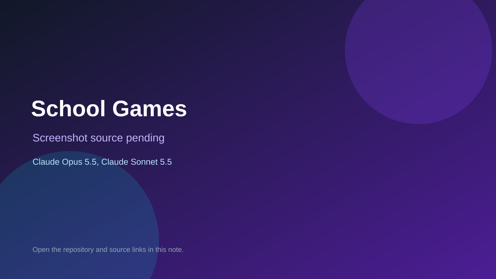

# School Games

> Verified game note.

## At a glance

- **Score:** 7.5/10
- **Model:** Claude Opus 5.5, Claude Sonnet 5.5
- **Technology:** TypeScript, Three.js, cannon-es, Browser
- **Estimated FP32 operations/s at 60 FPS:** 600,000,000 (low confidence; static estimate, not measured).
- **Rating basis:** Estimated from README, source tree and commit history; no runtime playtest.
- **Verified:** 2026-10-15
- **Repository:** [https://github.com/kl534/SchoolGames](https://github.com/kl534/SchoolGames)
- **Evidence:** [direct model evidence](https://github.com/kl534/SchoolGames/commit/3f4337969e7af775b2f069f2b65d1f8b8329575e)
- **Live demo:** [open demo](https://kl534.github.io/SchoolGames/)

## Screenshots

No screenshot source is recorded yet. Keep the placeholder until a repository, awesome list, or creator source provides an image.

## Model attribution

Open the evidence link above. Evidence grade: **direct model evidence**.

## Source description

Educational browser 3D games for phones, tablets and school Chromebooks/iPads; counted as one aggregate unit; Claude Opus 5.5 and Sonnet 5.5 trailers. Live demo returned HTTP 200 (availability only, not a playtest). Source inspected only; no playtest.

### Gameplay source

- [https://github.com/kl534/SchoolGames/blob/main/eslint.config.js](https://github.com/kl534/SchoolGames/blob/main/eslint.config.js)
- [https://github.com/kl534/SchoolGames/commit/3f4337969e7af775b2f069f2b65d1f8b8329575e](https://github.com/kl534/SchoolGames/commit/3f4337969e7af775b2f069f2b65d1f8b8329575e)

## Verification notes

- **Status:** verified_source_and_live_demo
- **Counted units in repository:** 1
- **Units covered by this note:** 1
- **Discovery:** GitHub commit pool: model+game commits 2026-10-08..2026-10-15 joined to repositories created after 2026-10-07T17:00Z; https://github.com/kl534/SchoolGames

[Back to the awesome list](../../README.md)
