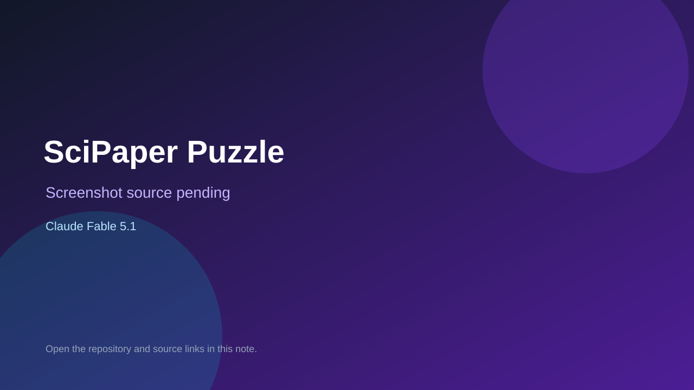

# SciPaper Puzzle

> Verified game note.

## At a glance

- **Score:** 7.3/10
- **Model:** Claude Fable 5.1
- **Technology:** TypeScript, Browser, React
- **Estimated FP32 operations/s at 60 FPS:** 10,000,000 (low confidence; static estimate, not measured).
- **Rating basis:** Heuristic from source size, README and commit history (5.8 + 0.6*log10(code KB+1), +0.3 with a reachable demo); no runtime playtest.
- **Verified:** 2026-10-16
- **Repository:** [https://github.com/hazanaya/scipaper-puzzle](https://github.com/hazanaya/scipaper-puzzle)
- **Evidence:** [direct model evidence](https://github.com/hazanaya/scipaper-puzzle/commit/9e7c99bf68976be399f7b5c902c8933202dfec9d)
- **Live demo:** [open demo](https://hazanaya.github.io/scipaper-puzzle/)

## Screenshots

No screenshot source is recorded yet. Keep the placeholder until a repository, awesome list, or creator source provides an image.

## Model attribution

Open the evidence link above. Evidence grade: **direct model evidence**.

## Source description

Web game that cuts a scientific paper into cards to reassemble, then asks you to write the ending before revealing it. Commit carries an exact Claude Fable 5.1 co-author trailer. Live demo returned HTTP 200 (availability only, not a playtest). Source inspected only; no playtest.

### Gameplay source

- [https://github.com/hazanaya/scipaper-puzzle/blob/main/src/core/sections.ts](https://github.com/hazanaya/scipaper-puzzle/blob/main/src/core/sections.ts)
- [https://github.com/hazanaya/scipaper-puzzle/commit/9e7c99bf68976be399f7b5c902c8933202dfec9d](https://github.com/hazanaya/scipaper-puzzle/commit/9e7c99bf68976be399f7b5c902c8933202dfec9d)

## Verification notes

- **Status:** verified_source
- **Counted units in repository:** 1
- **Units covered by this note:** 1
- **Discovery:** GitHub commit pool: model+game commits 2026-10-15..2026-10-16 (6-hour UTC partitions) joined to repositories created after 2026-10-14T17:00Z; https://github.com/hazanaya/scipaper-puzzle

[Back to the awesome list](../../README.md)
