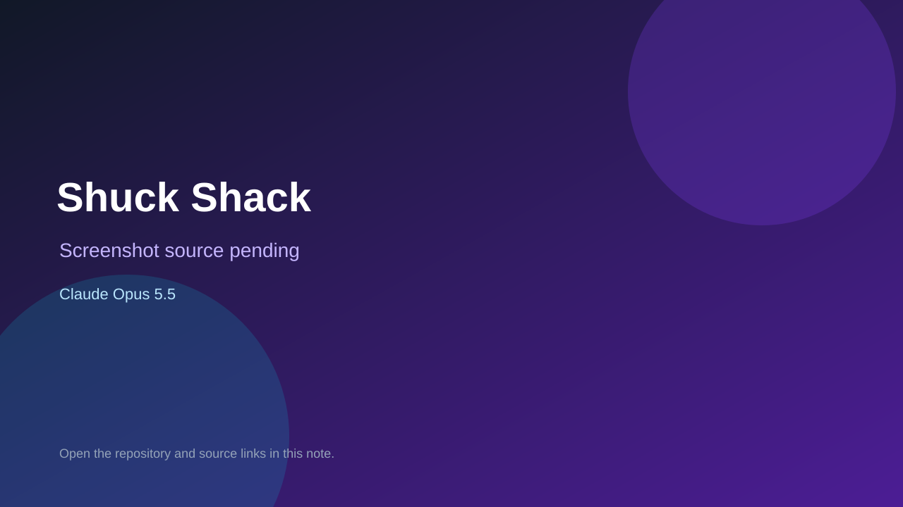

# Shuck Shack

> Verified game note.

## At a glance

- **Score:** 7.1/10
- **Model:** Claude Opus 5.5
- **Technology:** JavaScript, Browser
- **Estimated FP32 operations/s at 60 FPS:** 10,000,000 (low confidence; static estimate, not measured).
- **Rating basis:** Heuristic from source size, README and commit history (5.8 + 0.6*log10(code KB+1), +0.3 with a reachable demo); no runtime playtest.
- **Verified:** 2026-10-21
- **Repository:** [https://github.com/Stephen-Petronis/shuck-shack](https://github.com/Stephen-Petronis/shuck-shack)
- **Evidence:** [direct model evidence](https://github.com/Stephen-Petronis/shuck-shack/commit/88486a8bd743779b26d6cf90465571be4442bb57)

## Screenshots

No screenshot source is recorded yet. Keep the placeholder until a repository, awesome list, or creator source provides an image.

## Model attribution

Open the evidence link above. Evidence grade: **direct model evidence**.

## Source description

Trace around each oyster to pop its top shell. Every shift is one order on the clock. Neat, fast shucking earns cash and speedy tips. Spend it on better knives, gloves, first aid, a bigger ice bin and a tip jar, then earn a 5-star reputation and save up to… Commit carries an exact Claude Opus 5.5 co-author trailer. Source inspected from README, file tree and commit history only; no playtest.

### Gameplay source

- [https://github.com/Stephen-Petronis/shuck-shack/blob/main/game.js](https://github.com/Stephen-Petronis/shuck-shack/blob/main/game.js)
- [https://github.com/Stephen-Petronis/shuck-shack/commit/88486a8bd743779b26d6cf90465571be4442bb57](https://github.com/Stephen-Petronis/shuck-shack/commit/88486a8bd743779b26d6cf90465571be4442bb57)

## Verification notes

- **Status:** verified_source
- **Counted units in repository:** 1
- **Units covered by this note:** 1
- **Discovery:** GitHub commit pool: model+game commits 2026-10-17T01:00Z..2026-10-21T01:00Z (1-hour Opus, 3-hour Sonnet, 6-hour other UTC partitions) joined to repositories created after 2026-10-17T00:00Z; https://github.com/Stephen-Petronis/shuck-shack

[Back to the awesome list](../../README.md)
