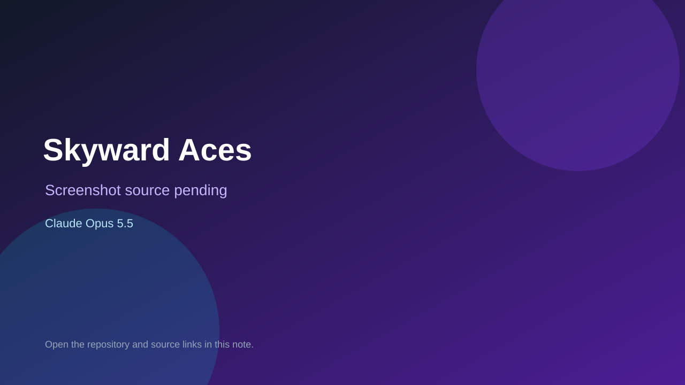

# Skyward Aces

> Verified game note.

## At a glance

- **Score:** 7.9/10
- **Model:** Claude Opus 5.5
- **Technology:** JavaScript, Three.js, Browser
- **Estimated FP32 operations/s at 60 FPS:** 1,000,000,000 (low confidence; static estimate, not measured).
- **Rating basis:** Heuristic from source size, README and commit history (5.8 + 0.6*log10(code KB+1), +0.3 with a reachable demo); no runtime playtest.
- **Verified:** 2026-10-21
- **Repository:** [https://github.com/xanderjt23-prog/Skyward-Aces](https://github.com/xanderjt23-prog/Skyward-Aces)
- **Evidence:** [direct model evidence](https://github.com/xanderjt23-prog/Skyward-Aces/commit/f5a182049e9ef13e85becbdd5742dd98571387fb)

## Screenshots

No screenshot source is recorded yet. Keep the placeholder until a repository, awesome list, or creator source provides an image.

## Model attribution

Open the evidence link above. Evidence grade: **direct model evidence**.

## Source description

3d aircraft dogfighting game. Made with Claude. Commit carries an exact Claude Opus 5.5 co-author trailer. Source inspected from README, file tree and commit history only; no playtest.

### Gameplay source

- [https://github.com/xanderjt23-prog/Skyward-Aces/blob/main/assets/sounds/draken.js](https://github.com/xanderjt23-prog/Skyward-Aces/blob/main/assets/sounds/draken.js)
- [https://github.com/xanderjt23-prog/Skyward-Aces/commit/f5a182049e9ef13e85becbdd5742dd98571387fb](https://github.com/xanderjt23-prog/Skyward-Aces/commit/f5a182049e9ef13e85becbdd5742dd98571387fb)

## Verification notes

- **Status:** verified_source
- **Counted units in repository:** 1
- **Units covered by this note:** 1
- **Discovery:** GitHub repository search: exact model phrase, created 2026-10-17T01:30Z..2026-10-21T01:00Z; https://github.com/xanderjt23-prog/Skyward-Aces

[Back to the awesome list](../../README.md)
