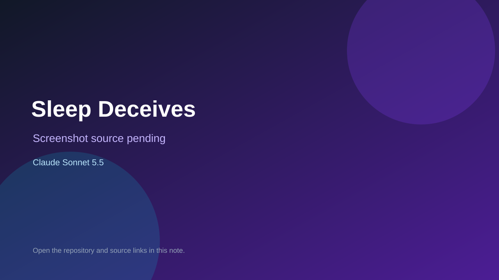

# Sleep Deceives

> Verified game note.

## At a glance

- **Score:** 7.7/10
- **Model:** Claude Sonnet 5.5
- **Technology:** JavaScript, Three.js, Browser, Node.js
- **Estimated FP32 operations/s at 60 FPS:** 1,000,000,000 (low confidence; static estimate, not measured).
- **Rating basis:** Heuristic from source size, README and commit history (5.8 + 0.6*log10(code KB+1), +0.3 with a reachable demo); no runtime playtest.
- **Verified:** 2026-10-16
- **Repository:** [https://github.com/ramenoruth-dev/sleep-deceives](https://github.com/ramenoruth-dev/sleep-deceives)
- **Evidence:** [direct model evidence](https://github.com/ramenoruth-dev/sleep-deceives/commit/edaed72a3b233fee7cda760e237c2648d8cb6aab)
- **Live demo:** [open demo](https://ramenoruth-dev.github.io/sleep-deceives/)

## Screenshots

No screenshot source is recorded yet. Keep the placeholder until a repository, awesome list, or creator source provides an image.

## Model attribution

Open the evidence link above. Evidence grade: **direct model evidence**.

## Source description

First-person psychological survival horror in three.js with Web Audio, solo and 1-4 player WebSocket co-op. Commit carries an exact Claude Sonnet 5.5 co-author trailer. Live demo returned HTTP 200 (availability only, not a playtest). Source inspected only; no playtest.

### Gameplay source

- [https://github.com/ramenoruth-dev/sleep-deceives/blob/main/docs/game.js](https://github.com/ramenoruth-dev/sleep-deceives/blob/main/docs/game.js)
- [https://github.com/ramenoruth-dev/sleep-deceives/commit/edaed72a3b233fee7cda760e237c2648d8cb6aab](https://github.com/ramenoruth-dev/sleep-deceives/commit/edaed72a3b233fee7cda760e237c2648d8cb6aab)

## Verification notes

- **Status:** verified_source
- **Counted units in repository:** 1
- **Units covered by this note:** 1
- **Discovery:** GitHub commit pool: model+game commits 2026-10-15..2026-10-16 (6-hour UTC partitions) joined to repositories created after 2026-10-14T17:00Z; https://github.com/ramenoruth-dev/sleep-deceives

[Back to the awesome list](../../README.md)
