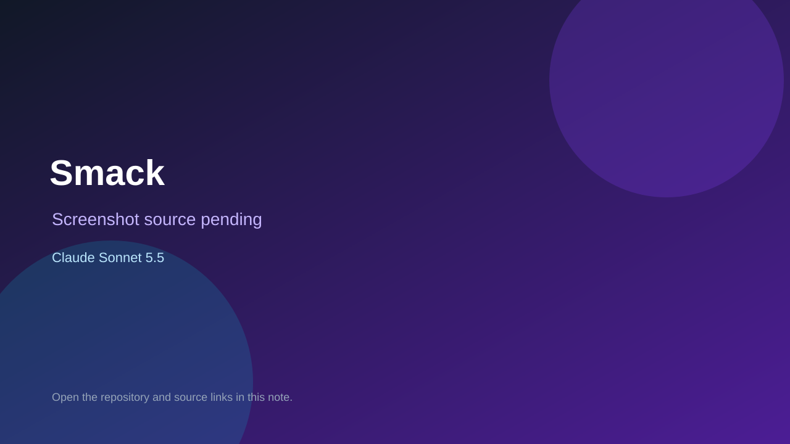

# Smack

> Verified game note.

## At a glance

- **Score:** 7.0/10
- **Model:** Claude Sonnet 5.5
- **Technology:** Godot, GDScript
- **Estimated FP32 operations/s at 60 FPS:** 300,000,000 (low confidence; static estimate, not measured).
- **Rating basis:** Estimated from README, source tree and commit history; no runtime playtest.
- **Verified:** 2026-10-15
- **Repository:** [https://github.com/NIGHT-Official/Spider-Smack](https://github.com/NIGHT-Official/Spider-Smack)
- **Evidence:** [direct model evidence](https://github.com/NIGHT-Official/Spider-Smack/commit/3fff95288931268f2365d4542162cf2c3c07ef78)

## Screenshots

No screenshot source is recorded yet. Keep the placeholder until a repository, awesome list, or creator source provides an image.

## Model attribution

Open the evidence link above. Evidence grade: **direct model evidence**.

## Source description

Godot 4 game: a spider is in your car while you drive, do not crash; Claude Sonnet 5.5 trailers. Source inspected only; no playtest.

### Gameplay source

- [https://github.com/NIGHT-Official/Spider-Smack/blob/main/camera_shake.gd](https://github.com/NIGHT-Official/Spider-Smack/blob/main/camera_shake.gd)
- [https://github.com/NIGHT-Official/Spider-Smack/commit/3fff95288931268f2365d4542162cf2c3c07ef78](https://github.com/NIGHT-Official/Spider-Smack/commit/3fff95288931268f2365d4542162cf2c3c07ef78)

## Verification notes

- **Status:** verified_source
- **Counted units in repository:** 1
- **Units covered by this note:** 1
- **Discovery:** GitHub commit pool: model+game commits 2026-10-08..2026-10-15 joined to repositories created after 2026-10-07T17:00Z; https://github.com/NIGHT-Official/Spider-Smack

[Back to the awesome list](../../README.md)
