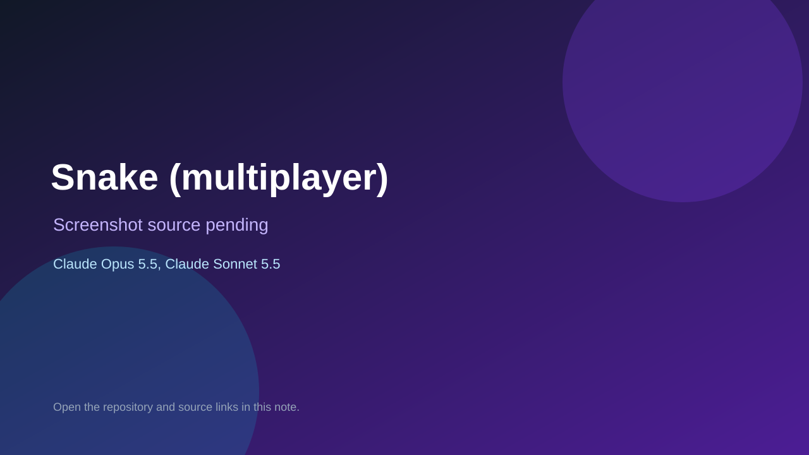

# Snake (multiplayer)

> Verified game note.

## At a glance

- **Score:** 7.0/10
- **Model:** Claude Opus 5.5, Claude Sonnet 5.5
- **Technology:** TypeScript, Node.js, Browser
- **Estimated FP32 operations/s at 60 FPS:** 100,000,000 (low confidence; static estimate, not measured).
- **Rating basis:** Heuristic from source size, README and commit history (5.8 + 0.6*log10(code KB+1), +0.3 with a reachable demo); no runtime playtest.
- **Verified:** 2026-10-16
- **Repository:** [https://github.com/gyuha/snake](https://github.com/gyuha/snake)
- **Evidence:** [direct model evidence](https://github.com/gyuha/snake/commit/8ef6f9f5c553b0f0329c0cd7c064c390b90f576f)

## Screenshots

No screenshot source is recorded yet. Keep the placeholder until a repository, awesome list, or creator source provides an image.

## Model attribution

Open the evidence link above. Evidence grade: **direct model evidence**.

## Source description

Multiplayer snake with a shared protocol, server and client packages (branch feature/snake-clone). Commit carries an exact Claude Opus 5.5 / Claude Sonnet 5.5 co-author trailer. Source inspected only; no playtest.

### Gameplay source

- [https://github.com/gyuha/snake/blob/feature/snake-clone/packages/shared/src/protocol.ts](https://github.com/gyuha/snake/blob/feature/snake-clone/packages/shared/src/protocol.ts)
- [https://github.com/gyuha/snake/commit/8ef6f9f5c553b0f0329c0cd7c064c390b90f576f](https://github.com/gyuha/snake/commit/8ef6f9f5c553b0f0329c0cd7c064c390b90f576f)

## Verification notes

- **Status:** verified_source
- **Counted units in repository:** 1
- **Units covered by this note:** 1
- **Discovery:** GitHub commit pool: model+game commits 2026-10-15..2026-10-16 (6-hour UTC partitions) joined to repositories created after 2026-10-14T17:00Z; https://github.com/gyuha/snake

[Back to the awesome list](../../README.md)
