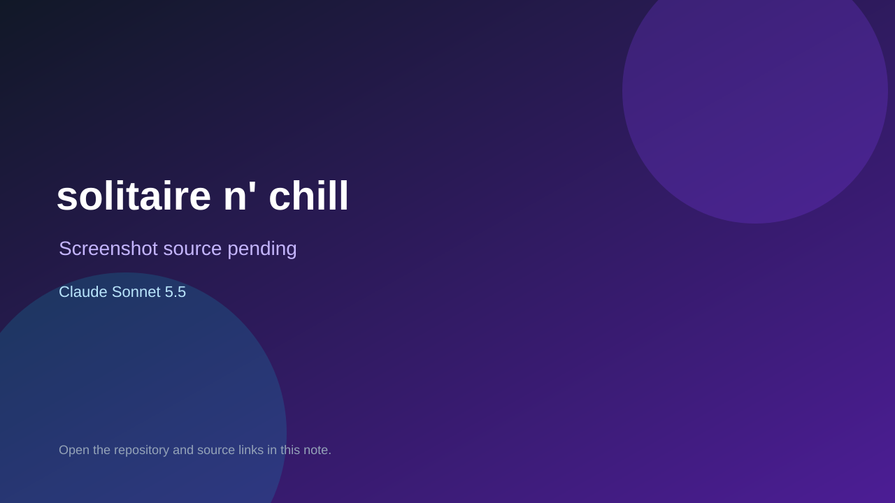

# solitaire n' chill

> Verified game note.

## At a glance

- **Score:** 7.3/10
- **Model:** Claude Sonnet 5.5
- **Technology:** HTML, JavaScript, Canvas, Browser
- **Estimated FP32 operations/s at 60 FPS:** 20,000,000 (low confidence; static estimate, not measured).
- **Rating basis:** Estimated from README, source tree and commit history; no runtime playtest.
- **Verified:** 2026-10-15
- **Repository:** [https://github.com/mjramos86/solitaire-n-chill](https://github.com/mjramos86/solitaire-n-chill)
- **Evidence:** [direct model evidence](https://github.com/mjramos86/solitaire-n-chill/commit/19bb19f2bbf7339a478cad60ef62f34f1a18d09b)

## Screenshots

No screenshot source is recorded yet. Keep the placeholder until a repository, awesome list, or creator source provides an image.

## Model attribution

Open the evidence link above. Evidence grade: **direct model evidence**.

## Source description

Customisable Klondike solitaire in the browser (draw one or three, pass limits); Claude Sonnet 5.5 trailers. Source inspected only; no playtest.

### Gameplay source

- [https://github.com/mjramos86/solitaire-n-chill/blob/main/index.html](https://github.com/mjramos86/solitaire-n-chill/blob/main/index.html)
- [https://github.com/mjramos86/solitaire-n-chill/commit/19bb19f2bbf7339a478cad60ef62f34f1a18d09b](https://github.com/mjramos86/solitaire-n-chill/commit/19bb19f2bbf7339a478cad60ef62f34f1a18d09b)

## Verification notes

- **Status:** verified_source
- **Counted units in repository:** 1
- **Units covered by this note:** 1
- **Discovery:** GitHub commit pool: model+game commits 2026-10-08..2026-10-15 joined to repositories created after 2026-10-07T17:00Z; https://github.com/mjramos86/solitaire-n-chill

[Back to the awesome list](../../README.md)
