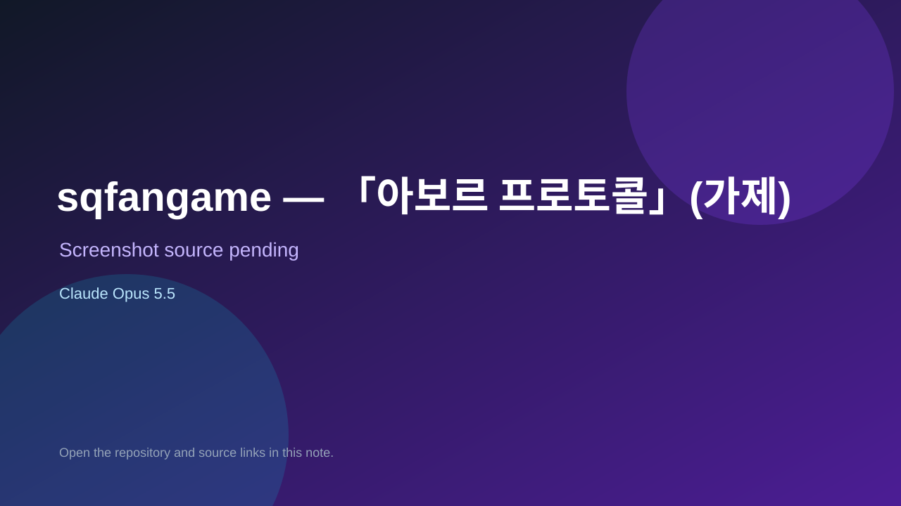

# sqfangame — 「아보르 프로토콜」(가제)

> Verified game note.

## At a glance

- **Score:** 6.5/10
- **Model:** Claude Opus 5.5
- **Technology:** Godot, GDScript
- **Estimated FP32 operations/s at 60 FPS:** 1,000,000,000 (low confidence; static estimate, not measured).
- **Rating basis:** Heuristic from source size, README and commit history (5.8 + 0.6*log10(code KB+1), +0.3 with a reachable demo); no runtime playtest.
- **Verified:** 2026-10-17
- **Repository:** [https://github.com/alsskdhgkdy2-creator/sqfangame](https://github.com/alsskdhgkdy2-creator/sqfangame)
- **Evidence:** [direct model evidence](https://github.com/alsskdhgkdy2-creator/sqfangame/commit/b71d66ba1a74f2d1583686a471ad6e765153adb1)

## Screenshots

No screenshot source is recorded yet. Keep the placeholder until a repository, awesome list, or creator source provides an image.

## Model attribution

Open the evidence link above. Evidence grade: **direct model evidence**.

## Source description

아틀라스 「세계수의 미궁(Etrian Odyssey)」 시리즈의 비공식 팬게임. 신작을 기다리던 팬이 직접 만드는 2차 창작 후속작으로, 1인칭 그리드 탐사·손으로 그리는 지도·FOE·5인 직업 파티와 원작의 그림체를 이어받아 "사이버네틱한 세계수의 미궁"을 그린다: 사이버네틱 몸 위에 홀로그램으로 판타지 기사·마법사의 모습을 투사한다. Commit carries an exact Claude Opus 5.5 co-author trailer. Source inspected from README, file tree and commit history only; no playtest.

### Gameplay source

- [https://github.com/alsskdhgkdy2-creator/sqfangame/blob/main/tools/tile_check.py](https://github.com/alsskdhgkdy2-creator/sqfangame/blob/main/tools/tile_check.py)
- [https://github.com/alsskdhgkdy2-creator/sqfangame/commit/b71d66ba1a74f2d1583686a471ad6e765153adb1](https://github.com/alsskdhgkdy2-creator/sqfangame/commit/b71d66ba1a74f2d1583686a471ad6e765153adb1)

## Verification notes

- **Status:** verified_source
- **Counted units in repository:** 1
- **Units covered by this note:** 1
- **Discovery:** GitHub commit pool: model+game commits 2026-10-16..2026-10-17 (1-hour Opus, 3-hour Sonnet, 6-hour other UTC partitions) joined to repositories created after 2026-10-16T00:00Z; https://github.com/alsskdhgkdy2-creator/sqfangame

[Back to the awesome list](../../README.md)
