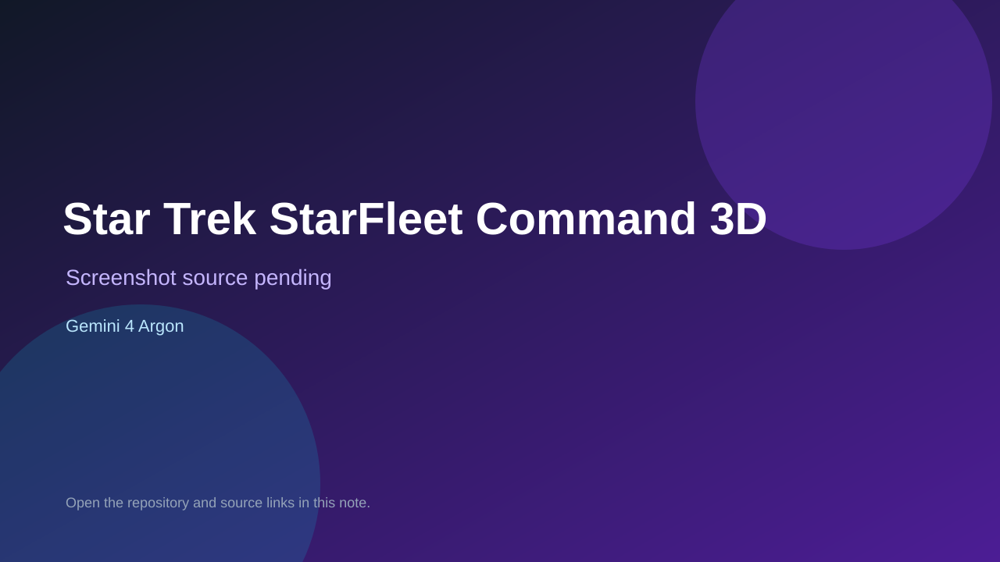

# Star Trek StarFleet Command 3D

> Verified game note.

## At a glance

- **Score:** 7.2/10
- **Model:** Gemini 4 Argon
- **Technology:** JavaScript, Three.js, Browser
- **Estimated FP32 operations/s at 60 FPS:** 1,000,000,000 (low confidence; static estimate, not measured).
- **Rating basis:** Heuristic from source size, README and commit history (5.8 + 0.6*log10(code KB+1), +0.3 with a reachable demo); no runtime playtest.
- **Verified:** 2026-10-16
- **Repository:** [https://github.com/testingyoubob/Star-Trek-StarFleet-Command-game-](https://github.com/testingyoubob/Star-Trek-StarFleet-Command-game-)
- **Evidence:** [inferred model evidence](https://github.com/testingyoubob/Star-Trek-StarFleet-Command-game-)

## Screenshots

No screenshot source is recorded yet. Keep the placeholder until a repository, awesome list, or creator source provides an image.

## Model attribution

Open the evidence link above. Evidence grade: **inferred model evidence**.

## Source description

Single-file 3D Star Trek starship game (~205 KB). The description says only "Gemini 4 made this", so Gemini 4 Argon is inferred. Source inspected only; no playtest.

### Gameplay source

- [https://github.com/testingyoubob/Star-Trek-StarFleet-Command-game-/blob/main/star_trek_starfleet_command_3d.html](https://github.com/testingyoubob/Star-Trek-StarFleet-Command-game-/blob/main/star_trek_starfleet_command_3d.html)
- [https://github.com/testingyoubob/Star-Trek-StarFleet-Command-game-](https://github.com/testingyoubob/Star-Trek-StarFleet-Command-game-)

## Verification notes

- **Status:** verified_source
- **Counted units in repository:** 1
- **Units covered by this note:** 1
- **Discovery:** GitHub repository search: exact model phrase, created 2026-10-14T17:00Z..2026-10-16T02:00Z; https://github.com/testingyoubob/Star-Trek-StarFleet-Command-game-

[Back to the awesome list](../../README.md)
