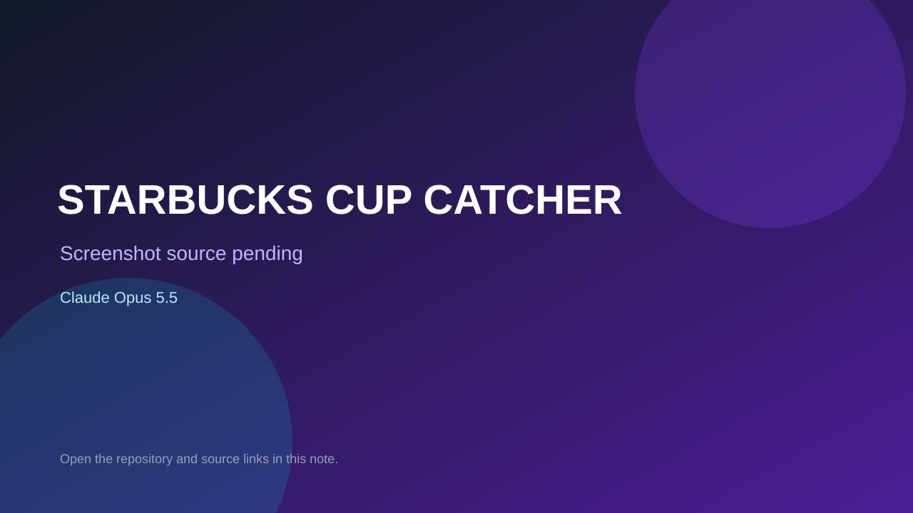

# STARBUCKS CUP CATCHER

> Verified game note.

## At a glance

- **Score:** 7.7/10
- **Model:** Claude Opus 5.5
- **Technology:** JavaScript, Phaser, Browser
- **Estimated FP32 operations/s at 60 FPS:** 100,000,000 (low confidence; static estimate, not measured).
- **Rating basis:** Heuristic from source size, README and commit history (5.8 + 0.6*log10(code KB+1), +0.3 with a reachable demo); no runtime playtest.
- **Verified:** 2026-10-21
- **Repository:** [https://github.com/zeusmess/zeusstudio](https://github.com/zeusmess/zeusstudio)
- **Evidence:** [direct model evidence](https://github.com/zeusmess/zeusstudio/commit/792a887767d6a00c2961db3d9e1982af8fbbbdbc)

## Screenshots

No screenshot source is recorded yet. Keep the placeholder until a repository, awesome list, or creator source provides an image.

## Model attribution

Open the evidence link above. Evidence grade: **direct model evidence**.

## Source description

Move the basket, catch the falling drinks, chain combos, clear 15 levels, then chase high scores in Endless Mode or challenge a friend online with an invitation code. Commit carries an exact Claude Opus 5.5 co-author trailer. Source inspected from README, file tree and commit history only; no playtest.

### Gameplay source

- [https://github.com/zeusmess/zeusstudio/blob/ccr-3d3a4c94-e98yc1/career/src/legacy/game.js](https://github.com/zeusmess/zeusstudio/blob/ccr-3d3a4c94-e98yc1/career/src/legacy/game.js)
- [https://github.com/zeusmess/zeusstudio/commit/792a887767d6a00c2961db3d9e1982af8fbbbdbc](https://github.com/zeusmess/zeusstudio/commit/792a887767d6a00c2961db3d9e1982af8fbbbdbc)

## Verification notes

- **Status:** verified_source
- **Counted units in repository:** 1
- **Units covered by this note:** 1
- **Discovery:** GitHub commit pool: model+game commits 2026-10-17T01:00Z..2026-10-21T01:00Z (1-hour Opus, 3-hour Sonnet, 6-hour other UTC partitions) joined to repositories created after 2026-10-17T00:00Z; https://github.com/zeusmess/zeusstudio

[Back to the awesome list](../../README.md)
