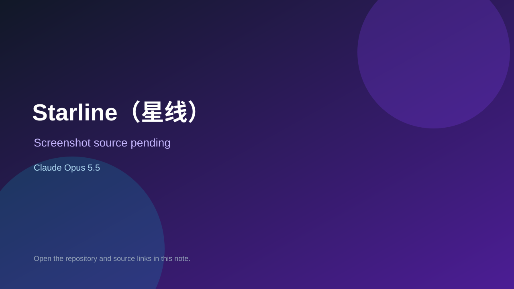

# Starline（星线）

> Verified game note.

## At a glance

- **Score:** 7.3/10
- **Model:** Claude Opus 5.5
- **Technology:** C#
- **Estimated FP32 operations/s at 60 FPS:** 1,000,000,000 (low confidence; static estimate, not measured).
- **Rating basis:** Heuristic from source size, README and commit history (5.8 + 0.6*log10(code KB+1), +0.3 with a reachable demo); no runtime playtest.
- **Verified:** 2026-10-21
- **Repository:** [https://github.com/xuleiknave/XFramework](https://github.com/xuleiknave/XFramework)
- **Evidence:** [direct model evidence](https://github.com/xuleiknave/XFramework/commit/3bc27aaa530cf0a49970b9445ce34cc62320c491)

## Screenshots

No screenshot source is recorded yet. Keep the placeholder until a repository, awesome list, or creator source provides an image.

## Model attribution

Open the evidence link above. Evidence grade: **direct model evidence**.

## Source description

单机奇幻战略游戏：亡灵吸干了连接人类城邦的法力水晶网络“星线”，你率领晨星远征军一段段重新点亮它。战前排兵布阵，用魔网连接你的角色，开战前先推演一百场战争，然后看远征军自动交火决出胜负。. Commit carries an exact Claude Opus 5.5 co-author trailer. Source inspected from README, file tree and commit history only; no playtest.

### Gameplay source

- [https://github.com/xuleiknave/XFramework/blob/main/tools/models/build_models.py](https://github.com/xuleiknave/XFramework/blob/main/tools/models/build_models.py)
- [https://github.com/xuleiknave/XFramework/commit/3bc27aaa530cf0a49970b9445ce34cc62320c491](https://github.com/xuleiknave/XFramework/commit/3bc27aaa530cf0a49970b9445ce34cc62320c491)

## Verification notes

- **Status:** verified_source
- **Counted units in repository:** 1
- **Units covered by this note:** 1
- **Discovery:** GitHub commit pool: model+game commits 2026-10-17T01:00Z..2026-10-21T01:00Z (1-hour Opus, 3-hour Sonnet, 6-hour other UTC partitions) joined to repositories created after 2026-10-17T00:00Z; https://github.com/xuleiknave/XFramework

[Back to the awesome list](../../README.md)
