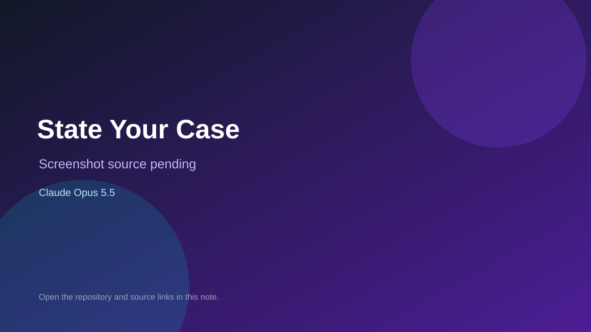

# State Your Case

> Verified game note.

## At a glance

- **Score:** 7.2/10
- **Model:** Claude Opus 5.5
- **Technology:** TypeScript, React, Browser
- **Estimated FP32 operations/s at 60 FPS:** 50,000,000 (low confidence; static estimate, not measured).
- **Rating basis:** Estimated from README, source tree and commit history; no runtime playtest.
- **Verified:** 2026-10-15
- **Repository:** [https://github.com/GiantMushy/StateYourCase](https://github.com/GiantMushy/StateYourCase)
- **Evidence:** [direct model evidence](https://github.com/GiantMushy/StateYourCase/commit/a53a480e6d03d0899a28787214ca1546dc20e602)

## Screenshots

No screenshot source is recorded yet. Keep the placeholder until a repository, awesome list, or creator source provides an image.

## Model attribution

Open the evidence link above. Evidence grade: **direct model evidence**.

## Source description

Pass-the-phone party debate game with groups, secret corruptions, accusations and voting; web React port of the studio's own game; Claude Opus 5.5 trailers. Source inspected only; no playtest.

### Gameplay source

- [https://github.com/GiantMushy/StateYourCase/blob/main/e2e/full-game.spec.ts](https://github.com/GiantMushy/StateYourCase/blob/main/e2e/full-game.spec.ts)
- [https://github.com/GiantMushy/StateYourCase/commit/a53a480e6d03d0899a28787214ca1546dc20e602](https://github.com/GiantMushy/StateYourCase/commit/a53a480e6d03d0899a28787214ca1546dc20e602)

## Verification notes

- **Status:** verified_source
- **Counted units in repository:** 1
- **Units covered by this note:** 1
- **Discovery:** GitHub commit pool: model+game commits 2026-10-08..2026-10-15 joined to repositories created after 2026-10-07T17:00Z; https://github.com/GiantMushy/StateYourCase

[Back to the awesome list](../../README.md)
