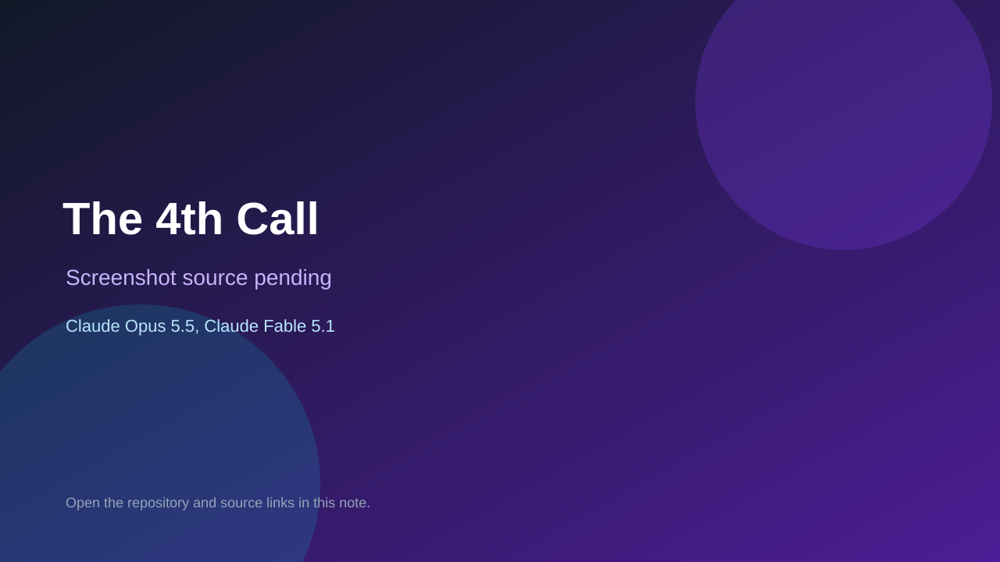

# The 4th Call

> Verified game note.

## At a glance

- **Score:** 7.8/10
- **Model:** Claude Opus 5.5, Claude Fable 5.1
- **Technology:** TypeScript, React, Browser
- **Estimated FP32 operations/s at 60 FPS:** 10,000,000 (low confidence; static estimate, not measured).
- **Rating basis:** Heuristic from source size, README and commit history (5.8 + 0.6*log10(code KB+1), +0.3 with a reachable demo); no runtime playtest.
- **Verified:** 2026-10-17
- **Repository:** [https://github.com/Hparker6/nfl-2min-drill](https://github.com/Hparker6/nfl-2min-drill)
- **Evidence:** [direct model evidence](https://github.com/Hparker6/nfl-2min-drill/commit/2e90390de9bbf192e4171e86684c530958d21efa)
- **Live demo:** [open demo](https://nfl-2min-drill.com)

## Screenshots

No screenshot source is recorded yet. Keep the placeholder until a repository, awesome list, or creator source provides an image.

## Model attribution

Open the evidence link above. Evidence grade: **direct model evidence**.

## Source description

A browser game about late-game football play-calling. You get the score, the clock, the timeouts and 22 players on the. Commit carries an exact Claude Opus 5.5 / Claude Fable 5.1 co-author trailer. Live demo returned HTTP 200 (availability only, not a playtest). Source inspected from README, file tree and commit history only; no playtest.

### Gameplay source

- [https://github.com/Hparker6/nfl-2min-drill/blob/main/src/engine/timeline.ts](https://github.com/Hparker6/nfl-2min-drill/blob/main/src/engine/timeline.ts)
- [https://github.com/Hparker6/nfl-2min-drill/commit/2e90390de9bbf192e4171e86684c530958d21efa](https://github.com/Hparker6/nfl-2min-drill/commit/2e90390de9bbf192e4171e86684c530958d21efa)

## Verification notes

- **Status:** verified_source
- **Counted units in repository:** 1
- **Units covered by this note:** 1
- **Discovery:** GitHub commit pool: model+game commits 2026-10-16..2026-10-17 (1-hour Opus, 3-hour Sonnet, 6-hour other UTC partitions) joined to repositories created after 2026-10-16T00:00Z; https://github.com/Hparker6/nfl-2min-drill

[Back to the awesome list](../../README.md)
