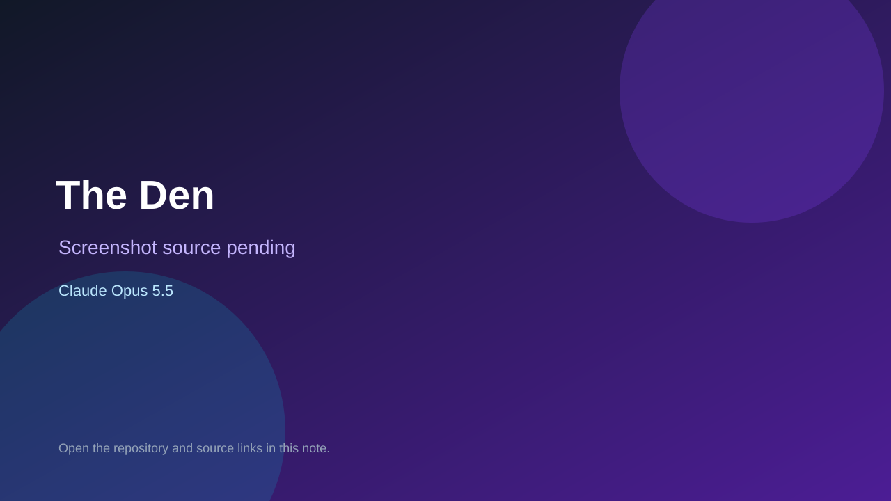

# The Den

> Verified game note.

## At a glance

- **Score:** 7.8/10
- **Model:** Claude Opus 5.5
- **Technology:** JavaScript, Three.js, Browser, Multiplayer
- **Estimated FP32 operations/s at 60 FPS:** 800,000,000 (low confidence; static estimate, not measured).
- **Rating basis:** Estimated from README, source tree and commit history; no runtime playtest.
- **Verified:** 2026-10-15
- **Repository:** [https://github.com/aboston678/the-den](https://github.com/aboston678/the-den)
- **Evidence:** [direct model evidence](https://github.com/aboston678/the-den/commit/3402d9606f5f7a1d6502e0796219ed3a85b0fe67)
- **Live demo:** [open demo](https://the-den-phi.vercel.app)

## Screenshots

No screenshot source is recorded yet. Keep the placeholder until a repository, awesome list, or creator source provides an image.

## Model attribution

Open the evidence link above. Evidence grade: **direct model evidence**.

## Source description

Private multiplayer 3D browser game in the Maine woods with bears, a farmhouse, fishing, bowling and Catan with friends; Claude Opus 5.5 trailers on every inspected commit. Live demo returned HTTP 200 (availability only, not a playtest). Source inspected only; no playtest.

### Gameplay source

- [https://github.com/aboston678/the-den/blob/main/client/anim-picker.html](https://github.com/aboston678/the-den/blob/main/client/anim-picker.html)
- [https://github.com/aboston678/the-den/commit/3402d9606f5f7a1d6502e0796219ed3a85b0fe67](https://github.com/aboston678/the-den/commit/3402d9606f5f7a1d6502e0796219ed3a85b0fe67)

## Verification notes

- **Status:** verified_source_and_live_demo
- **Counted units in repository:** 1
- **Units covered by this note:** 1
- **Discovery:** GitHub commit pool: model+game commits 2026-10-08..2026-10-15 joined to repositories created after 2026-10-07T17:00Z; https://github.com/aboston678/the-den

[Back to the awesome list](../../README.md)
