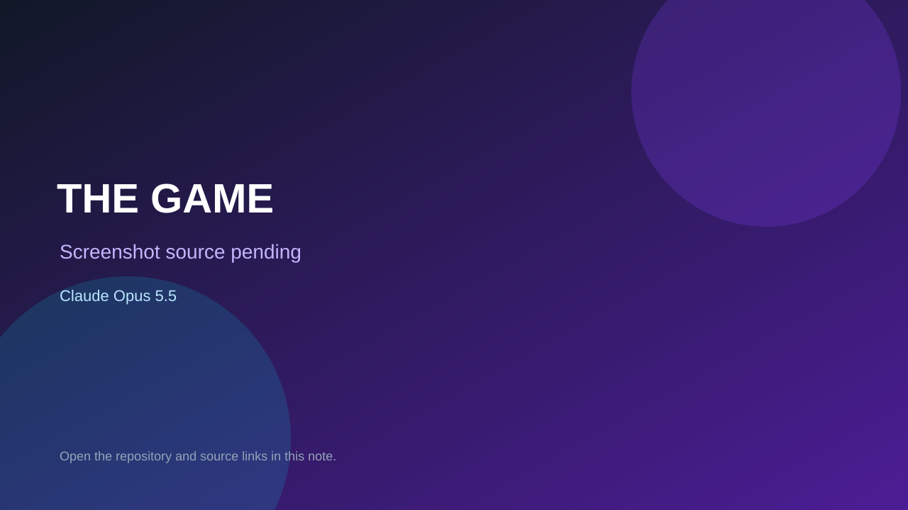

# THE GAME

> Verified game note.

## At a glance

- **Score:** 7.7/10
- **Model:** Claude Opus 5.5
- **Technology:** JavaScript, Three.js, React, Browser
- **Estimated FP32 operations/s at 60 FPS:** 1,000,000,000 (low confidence; static estimate, not measured).
- **Rating basis:** Heuristic from source size, README and commit history (5.8 + 0.6*log10(code KB+1), +0.3 with a reachable demo); no runtime playtest.
- **Verified:** 2026-10-17
- **Repository:** [https://github.com/neilmalvalli-cyber/THE_GAME](https://github.com/neilmalvalli-cyber/THE_GAME)
- **Evidence:** [direct model evidence](https://github.com/neilmalvalli-cyber/THE_GAME/commit/40494e99e0e10bf28bf2ed37684d80df7570b3ce)

## Screenshots

No screenshot source is recorded yet. Keep the placeholder until a repository, awesome list, or creator source provides an image.

## Model attribution

Open the evidence link above. Evidence grade: **direct model evidence**.

## Source description

A 3D investigation game: six case files on a detective's desk, a Normal Market and a Black Market selling power-ups, rival sabotage, and a locked phone whose code is assembled from the solved cases. Built on the THE HUNT backend (Next.js 16 + Supabase). Commit carries an exact Claude Opus 5.5 co-author trailer. Source inspected from README, file tree and commit history only; no playtest.

### Gameplay source

- [https://github.com/neilmalvalli-cyber/THE_GAME/blob/main/app/(admin)/ops/page.tsx](https://github.com/neilmalvalli-cyber/THE_GAME/blob/main/app/(admin)/ops/page.tsx)
- [https://github.com/neilmalvalli-cyber/THE_GAME/commit/40494e99e0e10bf28bf2ed37684d80df7570b3ce](https://github.com/neilmalvalli-cyber/THE_GAME/commit/40494e99e0e10bf28bf2ed37684d80df7570b3ce)

## Verification notes

- **Status:** verified_source
- **Counted units in repository:** 1
- **Units covered by this note:** 1
- **Discovery:** GitHub commit pool: model+game commits 2026-10-16..2026-10-17 (1-hour Opus, 3-hour Sonnet, 6-hour other UTC partitions) joined to repositories created after 2026-10-16T00:00Z; https://github.com/neilmalvalli-cyber/THE_GAME

[Back to the awesome list](../../README.md)
