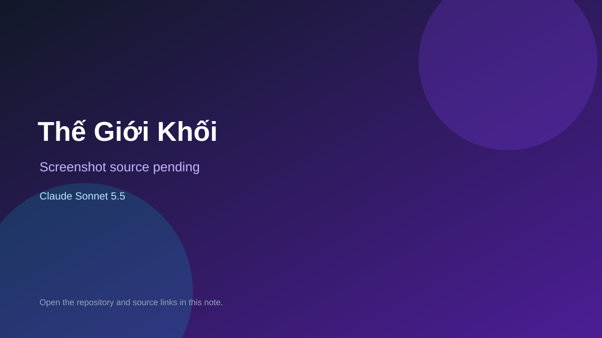

# Thế Giới Khối

> Verified game note.

## At a glance

- **Score:** 7.5/10
- **Model:** Claude Sonnet 5.5
- **Technology:** JavaScript, Three.js, Browser
- **Estimated FP32 operations/s at 60 FPS:** 1,000,000,000 (low confidence; static estimate, not measured).
- **Rating basis:** Heuristic from source size, README and commit history (5.8 + 0.6*log10(code KB+1), +0.3 with a reachable demo); no runtime playtest.
- **Verified:** 2026-10-17
- **Repository:** [https://github.com/vuthehuy1997/the-gioi-khoi](https://github.com/vuthehuy1997/the-gioi-khoi)
- **Evidence:** [direct model evidence](https://github.com/vuthehuy1997/the-gioi-khoi/commit/e8807a8891eb8f210bc92df58af927d2a880cfb4)
- **Live demo:** [open demo](https://vuthehuy1997.github.io/the-gioi-khoi/)

## Screenshots

No screenshot source is recorded yet. Keep the placeholder until a repository, awesome list, or creator source provides an image.

## Model attribution

Open the evidence link above. Evidence grade: **direct model evidence**.

## Source description

Thế Giới Khối — game thế giới khối nhiều người chơi trên trình duyệt (WebRTC P2P). Commit carries an exact Claude Sonnet 5.5 co-author trailer. Live demo returned HTTP 200 (availability only, not a playtest). Source inspected from README, file tree and commit history only; no playtest.

### Gameplay source

- [https://github.com/vuthehuy1997/the-gioi-khoi/blob/main/games/the-gioi-khoi/game.js](https://github.com/vuthehuy1997/the-gioi-khoi/blob/main/games/the-gioi-khoi/game.js)
- [https://github.com/vuthehuy1997/the-gioi-khoi/commit/e8807a8891eb8f210bc92df58af927d2a880cfb4](https://github.com/vuthehuy1997/the-gioi-khoi/commit/e8807a8891eb8f210bc92df58af927d2a880cfb4)

## Verification notes

- **Status:** verified_source
- **Counted units in repository:** 1
- **Units covered by this note:** 1
- **Discovery:** GitHub commit pool: model+game commits 2026-10-16..2026-10-17 (1-hour Opus, 3-hour Sonnet, 6-hour other UTC partitions) joined to repositories created after 2026-10-16T00:00Z; https://github.com/vuthehuy1997/the-gioi-khoi

[Back to the awesome list](../../README.md)
