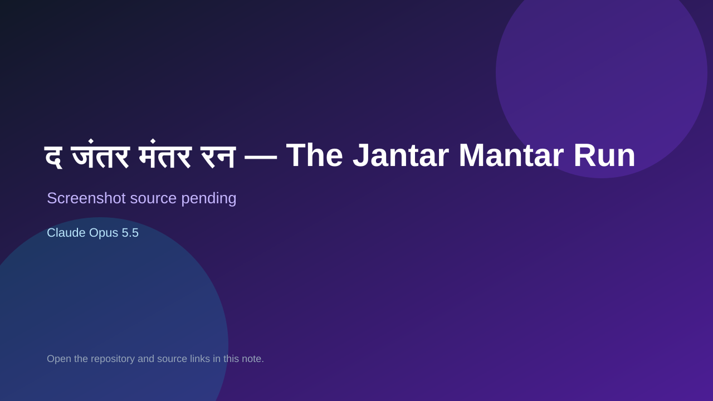

# द जंतर मंतर रन — The Jantar Mantar Run

> Verified game note.

## At a glance

- **Score:** 7.5/10
- **Model:** Claude Opus 5.5
- **Technology:** JavaScript, Browser
- **Estimated FP32 operations/s at 60 FPS:** 1,000,000,000 (low confidence; static estimate, not measured).
- **Rating basis:** Heuristic from source size, README and commit history (5.8 + 0.6*log10(code KB+1), +0.3 with a reachable demo); no runtime playtest.
- **Verified:** 2026-10-17
- **Repository:** [https://github.com/pratik-j-mahajan/The-Jantar-Mantar-Run](https://github.com/pratik-j-mahajan/The-Jantar-Mantar-Run)
- **Evidence:** [direct model evidence](https://github.com/pratik-j-mahajan/The-Jantar-Mantar-Run/commit/1358423884e3c18e01ec2261d24d08268b20352e)
- **Live demo:** [open demo](https://the-jantar-mantar-run.vercel.app)

## Screenshots

No screenshot source is recorded yet. Keep the placeholder until a repository, awesome list, or creator source provides an image.

## Model attribution

Open the evidence link above. Evidence grade: **direct model evidence**.

## Source description

A satirical, comic-style arcade run down a Delhi road to Jantar Mantar. It looks 3D but is drawn on a plain 2D canvas. You pick a protester and weave past police bus blockades, riot units, barricades and the orange-shirt stick squad, while a YouTube reporter… Commit carries an exact Claude Opus 5.5 co-author trailer. Live demo returned HTTP 200 (availability only, not a playtest). Source inspected from README, file tree and commit history only; no playtest.

### Gameplay source

- [https://github.com/pratik-j-mahajan/The-Jantar-Mantar-Run/blob/main/js/game.js](https://github.com/pratik-j-mahajan/The-Jantar-Mantar-Run/blob/main/js/game.js)
- [https://github.com/pratik-j-mahajan/The-Jantar-Mantar-Run/commit/1358423884e3c18e01ec2261d24d08268b20352e](https://github.com/pratik-j-mahajan/The-Jantar-Mantar-Run/commit/1358423884e3c18e01ec2261d24d08268b20352e)

## Verification notes

- **Status:** verified_source
- **Counted units in repository:** 1
- **Units covered by this note:** 1
- **Discovery:** GitHub commit pool: model+game commits 2026-10-16..2026-10-17 (1-hour Opus, 3-hour Sonnet, 6-hour other UTC partitions) joined to repositories created after 2026-10-16T00:00Z; https://github.com/pratik-j-mahajan/The-Jantar-Mantar-Run

[Back to the awesome list](../../README.md)
