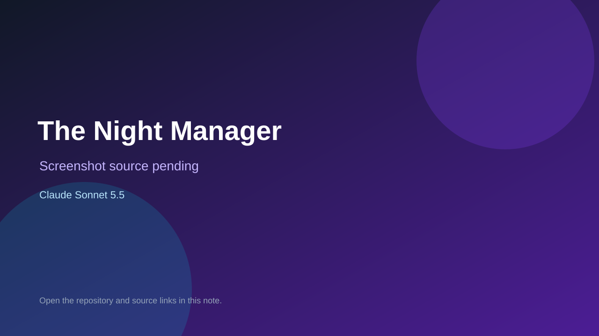

# The Night Manager

> Verified game note.

## At a glance

- **Score:** 7.5/10
- **Model:** Claude Sonnet 5.5
- **Technology:** Luau, Roblox, Rojo
- **Estimated FP32 operations/s at 60 FPS:** 600,000,000 (low confidence; static estimate, not measured).
- **Rating basis:** Estimated from README, source tree and commit history; no runtime playtest.
- **Verified:** 2026-10-15
- **Repository:** [https://github.com/poncema4/night-shift](https://github.com/poncema4/night-shift)
- **Evidence:** [direct model evidence](https://github.com/poncema4/night-shift/commit/7e59e0ca907ed824088c9e5dd360e979f1686bf2)

## Screenshots

No screenshot source is recorded yet. Keep the placeholder until a repository, awesome list, or creator source provides an image.

## Model attribution

Open the evidence link above. Evidence grade: **direct model evidence**.

## Source description

Multiplayer survival-horror, social-deduction and life-sim Roblox game kept as Luau with Rojo and Lune tests; Claude Sonnet 5.5 trailers. Needs Roblox to play. Source inspected only; no playtest.

### Gameplay source

- [https://github.com/poncema4/night-shift/blob/main/art/blender/common.py](https://github.com/poncema4/night-shift/blob/main/art/blender/common.py)
- [https://github.com/poncema4/night-shift/commit/7e59e0ca907ed824088c9e5dd360e979f1686bf2](https://github.com/poncema4/night-shift/commit/7e59e0ca907ed824088c9e5dd360e979f1686bf2)

## Verification notes

- **Status:** verified_source
- **Counted units in repository:** 1
- **Units covered by this note:** 1
- **Discovery:** GitHub commit pool: model+game commits 2026-10-08..2026-10-15 joined to repositories created after 2026-10-07T17:00Z; https://github.com/poncema4/night-shift

[Back to the awesome list](../../README.md)
