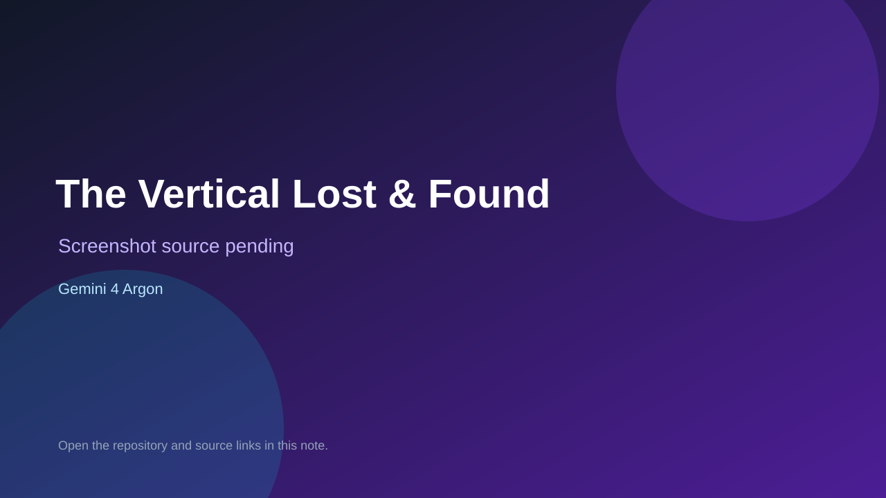

# The Vertical Lost & Found

> Top-list entry: **today** (#5), **this week** (#5), **this month** (#11).

## At a glance

- **Score:** 8.3/10
- **Model:** Gemini 4 Argon
- **Technology:** TypeScript, Three.js, Blender, Browser
- **Estimated FP32 operations/s at 60 FPS:** 800,000,000 (low confidence; static estimate, not measured).
- **Rating basis:** Estimated from README, source tree and commit history; no runtime playtest.
- **Verified:** 2026-10-15
- **Repository:** [https://github.com/Emily2040/vertical-lost-and-found](https://github.com/Emily2040/vertical-lost-and-found)
- **Evidence:** [inferred model evidence](https://github.com/Emily2040/vertical-lost-and-found/blob/review/gemini-demo/README.md)

## Screenshots

No screenshot source is recorded yet. Keep the placeholder until a repository, awesome list, or creator source provides an image.

## Model attribution

Open the evidence link above. Evidence grade: **inferred model evidence**.

## Source description

Three-stage mechanical climbing puzzle in a railway archive: pull drawers, lock them and move luggage to drive lifts to the rooftop; 77 mechanics checks and a captured gameplay showcase. README says built with Gemini 4 in Google Antigravity (the variant is not named; Argon is inferred). Source inspected only; no playtest.

### Gameplay source

- [https://github.com/Emily2040/vertical-lost-and-found/blob/review/gemini-demo/authoring/railway-hall/audit_hall.py](https://github.com/Emily2040/vertical-lost-and-found/blob/review/gemini-demo/authoring/railway-hall/audit_hall.py)
- [https://github.com/Emily2040/vertical-lost-and-found/blob/review/gemini-demo/README.md](https://github.com/Emily2040/vertical-lost-and-found/blob/review/gemini-demo/README.md)

## Verification notes

- **Status:** verified_source
- **Counted units in repository:** 1
- **Units covered by this note:** 1
- **Discovery:** GitHub repository search: exact model phrase, created 2026-10-08..2026-10-15 (UTC partitions); https://github.com/Emily2040/vertical-lost-and-found

[Back to the awesome list](../../README.md)
