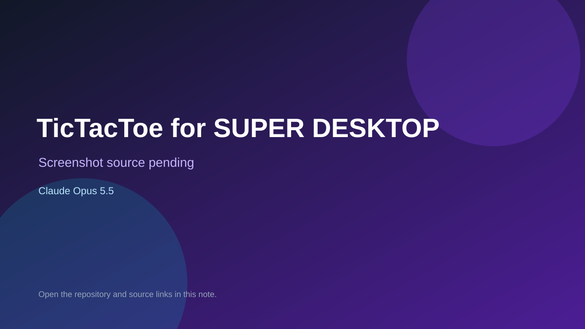

# TicTacToe for SUPER DESKTOP

> Verified game note.

## At a glance

- **Score:** 6.6/10
- **Model:** Claude Opus 5.5
- **Technology:** QML, JavaScript, Desktop
- **Estimated FP32 operations/s at 60 FPS:** 10,000,000 (low confidence; static estimate, not measured).
- **Rating basis:** Heuristic from source size, README and commit history (5.8 + 0.6*log10(code KB+1), +0.3 with a reachable demo); no runtime playtest.
- **Verified:** 2026-10-16
- **Repository:** [https://github.com/gladimdim/super-desktop-tictactoe](https://github.com/gladimdim/super-desktop-tictactoe)
- **Evidence:** [direct model evidence](https://github.com/gladimdim/super-desktop-tictactoe/commit/f20e2f81a40333b8afdc9c53fc5361487e5c2fa3)

## Screenshots

No screenshot source is recorded yet. Keep the placeholder until a repository, awesome list, or creator source provides an image.

## Model attribution

Open the evidence link above. Evidence grade: **direct model evidence**.

## Source description

Tic-tac-toe card plugin for the SUPER DESKTOP desktop: play the computer or a friend. Commit carries an exact Claude Opus 5.5 co-author trailer. Source inspected only; no playtest.

### Gameplay source

- [https://github.com/gladimdim/super-desktop-tictactoe/blob/main/Game.qml](https://github.com/gladimdim/super-desktop-tictactoe/blob/main/Game.qml)
- [https://github.com/gladimdim/super-desktop-tictactoe/commit/f20e2f81a40333b8afdc9c53fc5361487e5c2fa3](https://github.com/gladimdim/super-desktop-tictactoe/commit/f20e2f81a40333b8afdc9c53fc5361487e5c2fa3)

## Verification notes

- **Status:** verified_source
- **Counted units in repository:** 1
- **Units covered by this note:** 1
- **Discovery:** GitHub commit pool: model+game commits 2026-10-15..2026-10-16 (6-hour UTC partitions) joined to repositories created after 2026-10-14T17:00Z; https://github.com/gladimdim/super-desktop-tictactoe

[Back to the awesome list](../../README.md)
