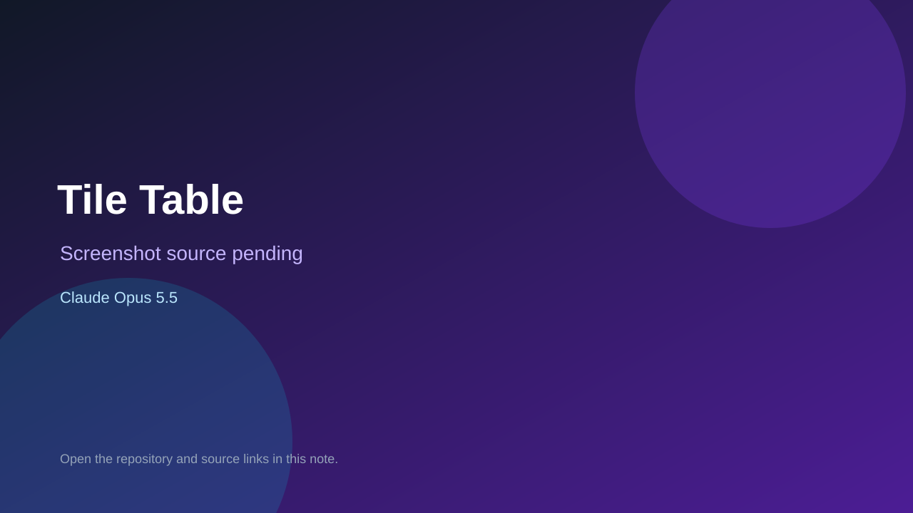

# Tile Table

> Verified game note.

## At a glance

- **Score:** 7.2/10
- **Model:** Claude Opus 5.5
- **Technology:** JavaScript, Browser
- **Estimated FP32 operations/s at 60 FPS:** 10,000,000 (low confidence; static estimate, not measured).
- **Rating basis:** Heuristic from source size, README and commit history (5.8 + 0.6*log10(code KB+1), +0.3 with a reachable demo); no runtime playtest.
- **Verified:** 2026-10-21
- **Repository:** [https://github.com/SamMcCormick61/tile-table](https://github.com/SamMcCormick61/tile-table)
- **Evidence:** [direct model evidence](https://github.com/SamMcCormick61/tile-table/commit/864c74f128929514daa91662778cf7b61daf6cc5)
- **Live demo:** [open demo](https://sammccormick61.github.io/tile-table/)

## Screenshots

No screenshot source is recorded yet. Keep the placeholder until a repository, awesome list, or creator source provides an image.

## Model attribution

Open the evidence link above. Evidence grade: **direct model evidence**.

## Source description

A crossword tile game for 2 to 4 players, each on their own device. Standard 15×15 board, 100 tiles, official scoring, and the TWL06 tournament word list. Commit carries an exact Claude Opus 5.5 co-author trailer. Live demo returned HTTP 200 (availability only, not a playtest). Source inspected from README, file tree and commit history only; no playtest.

### Gameplay source

- [https://github.com/SamMcCormick61/tile-table/blob/main/index.html](https://github.com/SamMcCormick61/tile-table/blob/main/index.html)
- [https://github.com/SamMcCormick61/tile-table/commit/864c74f128929514daa91662778cf7b61daf6cc5](https://github.com/SamMcCormick61/tile-table/commit/864c74f128929514daa91662778cf7b61daf6cc5)

## Verification notes

- **Status:** verified_source
- **Counted units in repository:** 1
- **Units covered by this note:** 1
- **Discovery:** GitHub commit pool: model+game commits 2026-10-17T01:00Z..2026-10-21T01:00Z (1-hour Opus, 3-hour Sonnet, 6-hour other UTC partitions) joined to repositories created after 2026-10-17T00:00Z; https://github.com/SamMcCormick61/tile-table

[Back to the awesome list](../../README.md)
