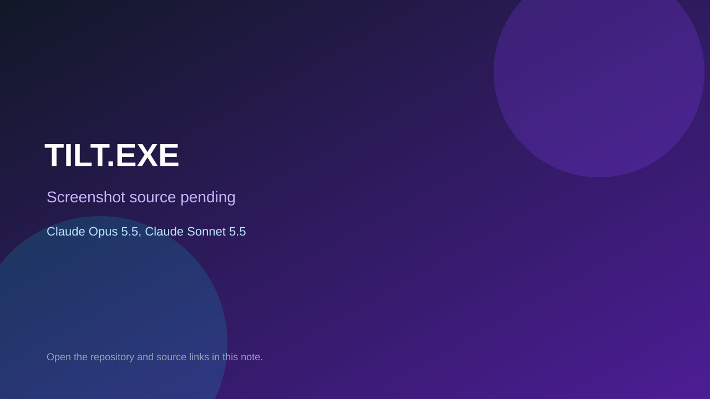

# TILT.EXE

> Verified game note.

## At a glance

- **Score:** 7.1/10
- **Model:** Claude Opus 5.5, Claude Sonnet 5.5
- **Technology:** JavaScript, Browser
- **Estimated FP32 operations/s at 60 FPS:** 10,000,000 (low confidence; static estimate, not measured).
- **Rating basis:** Heuristic from source size, README and commit history (5.8 + 0.6*log10(code KB+1), +0.3 with a reachable demo); no runtime playtest.
- **Verified:** 2026-10-23
- **Repository:** [https://github.com/okayline/clutch-feed-tilt](https://github.com/okayline/clutch-feed-tilt)
- **Evidence:** [direct model evidence](https://github.com/okayline/clutch-feed-tilt/commit/523a6d5695b2bda0175d2921805b0ed3bf6c2266)

## Screenshots

No screenshot source is recorded yet. Keep the placeholder until a repository, awesome list, or creator source provides an image.

## Model attribution

Open the evidence link above. Evidence grade: **direct model evidence**.

## Source description

A daily ASCII shooter. Everyone gets the same map each UTC day: two wings of that moon quarter's real 4Dungeon floor, with the doors opened by the day's ledger entry. You walk it (WASD, or a stick on a phone) and turn with the mouse, past 5 enemies, to the… Commit carries an exact Claude Opus 5.5 / Claude Sonnet 5.5 co-author trailer. Source inspected from README, file tree and commit history only; no playtest.

### Gameplay source

- [https://github.com/okayline/clutch-feed-tilt/blob/main/public/app.js](https://github.com/okayline/clutch-feed-tilt/blob/main/public/app.js)
- [https://github.com/okayline/clutch-feed-tilt/commit/523a6d5695b2bda0175d2921805b0ed3bf6c2266](https://github.com/okayline/clutch-feed-tilt/commit/523a6d5695b2bda0175d2921805b0ed3bf6c2266)

## Verification notes

- **Status:** verified_source
- **Counted units in repository:** 1
- **Units covered by this note:** 1
- **Discovery:** GitHub commit pool: model+game commits 2026-10-21T01:00Z..2026-10-23T01:00Z (20-minute Opus 5.5 and wider other-model UTC partitions) joined to repositories created after 2026-10-20T01:00Z; https://github.com/okayline/clutch-feed-tilt

[Back to the awesome list](../../README.md)
