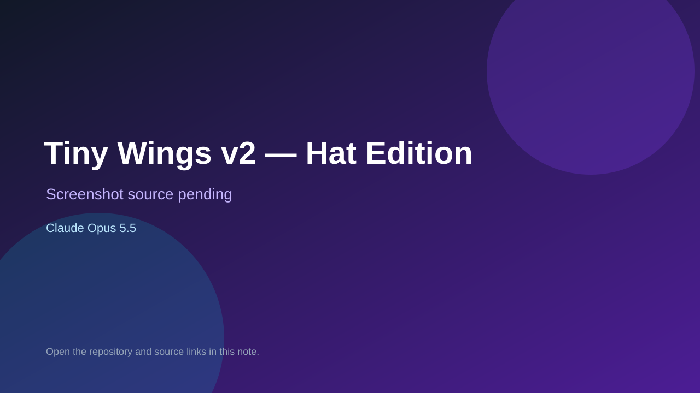

# Tiny Wings v2 — Hat Edition

> Verified game note.

## At a glance

- **Score:** 7.6/10
- **Model:** Claude Opus 5.5
- **Technology:** HTML, JavaScript, Canvas, Browser
- **Estimated FP32 operations/s at 60 FPS:** 100,000,000 (low confidence; static estimate, not measured).
- **Rating basis:** Estimated from README, source tree and commit history; no runtime playtest.
- **Verified:** 2026-10-15
- **Repository:** [https://github.com/felipegatoloko10/Tiny-Wings-v2](https://github.com/felipegatoloko10/Tiny-Wings-v2)
- **Evidence:** [creator-reported model evidence](https://github.com/felipegatoloko10/Tiny-Wings-v2/blob/main/README.md)
- **Live demo:** [open demo](https://tiny-wings-v2.vercel.app)

## Screenshots

No screenshot source is recorded yet. Keep the placeholder until a repository, awesome list, or creator source provides an image.

## Model attribution

Open the evidence link above. Evidence grade: **creator-reported model evidence**.

## Source description

Tiny Wings recreation with continuous hill physics, slide judging and a fever mode in game.js; README credits Claude Opus 5.5. No trailer. Live demo returned HTTP 200 (availability only, not a playtest). Source inspected only; no playtest.

### Gameplay source

- [https://github.com/felipegatoloko10/Tiny-Wings-v2/blob/main/game.js](https://github.com/felipegatoloko10/Tiny-Wings-v2/blob/main/game.js)
- [https://github.com/felipegatoloko10/Tiny-Wings-v2/blob/main/README.md](https://github.com/felipegatoloko10/Tiny-Wings-v2/blob/main/README.md)

## Verification notes

- **Status:** verified_source_and_live_demo
- **Counted units in repository:** 1
- **Units covered by this note:** 1
- **Discovery:** GitHub repository search: exact model phrase, created 2026-10-08..2026-10-15 (UTC partitions); https://github.com/felipegatoloko10/Tiny-Wings-v2

[Back to the awesome list](../../README.md)
