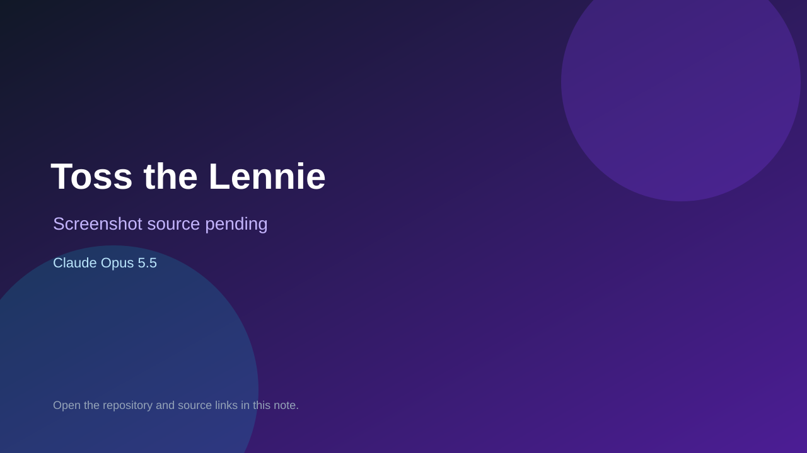

# Toss the Lennie

> Verified game note.

## At a glance

- **Score:** 7.4/10
- **Model:** Claude Opus 5.5
- **Technology:** JavaScript, Three.js, Browser
- **Estimated FP32 operations/s at 60 FPS:** 1,000,000,000 (low confidence; static estimate, not measured).
- **Rating basis:** Heuristic from source size, README and commit history (5.8 + 0.6*log10(code KB+1), +0.3 with a reachable demo); no runtime playtest.
- **Verified:** 2026-10-21
- **Repository:** [https://github.com/Klaboukes/TossTheLennie](https://github.com/Klaboukes/TossTheLennie)
- **Evidence:** [direct model evidence](https://github.com/Klaboukes/TossTheLennie/commit/0970c799d7a3cb4988f2a4904ab9cdb36a1dfa7e)
- **Live demo:** [open demo](https://klaboukes.github.io/TossTheLennie/)

## Screenshots

No screenshot source is recorded yet. Keep the placeholder until a repository, awesome list, or creator source provides an image.

## Model attribution

Open the evidence link above. Evidence grade: **direct model evidence**.

## Source description

Grab Lennie, a ragdoll, by any limb and fling him around a three-storey family house: through the rooms, down the stairs and out of the windows into the yard. Each toss scores points once he comes to rest, and the more contorted he ends up, the more it's… Commit carries an exact Claude Opus 5.5 co-author trailer. Live demo returned HTTP 200 (availability only, not a playtest). Source inspected from README, file tree and commit history only; no playtest.

### Gameplay source

- [https://github.com/Klaboukes/TossTheLennie/blob/main/src/main.js](https://github.com/Klaboukes/TossTheLennie/blob/main/src/main.js)
- [https://github.com/Klaboukes/TossTheLennie/commit/0970c799d7a3cb4988f2a4904ab9cdb36a1dfa7e](https://github.com/Klaboukes/TossTheLennie/commit/0970c799d7a3cb4988f2a4904ab9cdb36a1dfa7e)

## Verification notes

- **Status:** verified_source
- **Counted units in repository:** 1
- **Units covered by this note:** 1
- **Discovery:** GitHub commit pool: model+game commits 2026-10-17T01:00Z..2026-10-21T01:00Z (1-hour Opus, 3-hour Sonnet, 6-hour other UTC partitions) joined to repositories created after 2026-10-17T00:00Z; https://github.com/Klaboukes/TossTheLennie

[Back to the awesome list](../../README.md)
