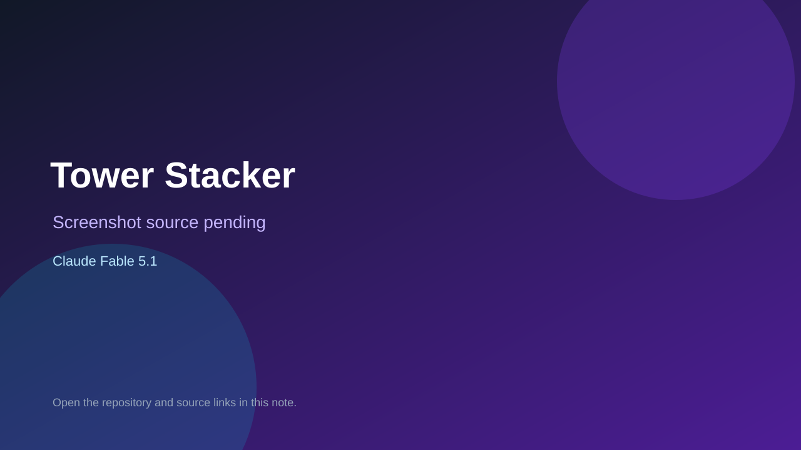

# Tower Stacker

> Verified game note.

## At a glance

- **Score:** 6.9/10
- **Model:** Claude Fable 5.1
- **Technology:** C#, Unity, Mobile
- **Estimated FP32 operations/s at 60 FPS:** 100,000,000 (low confidence; static estimate, not measured).
- **Rating basis:** Heuristic from source size, README and commit history (5.8 + 0.6*log10(code KB+1), +0.3 with a reachable demo); no runtime playtest.
- **Verified:** 2026-10-16
- **Repository:** [https://github.com/brotipss1-droid/tower-stacker](https://github.com/brotipss1-droid/tower-stacker)
- **Evidence:** [direct model evidence](https://github.com/brotipss1-droid/tower-stacker/commit/e78aa962b0e4f770e5c6d901d7e4259fa4fa8116)

## Screenshots

No screenshot source is recorded yet. Keep the placeholder until a repository, awesome list, or creator source provides an image.

## Model attribution

Open the evidence link above. Evidence grade: **direct model evidence**.

## Source description

Unity mobile block-stacking game: tap to drop sliding blocks, overhangs are cut off until the tower fails. Commit carries an exact Claude Fable 5.1 co-author trailer. Source inspected only; no playtest.

### Gameplay source

- [https://github.com/brotipss1-droid/tower-stacker/blob/main/Assets/Scripts/BosphorusScenery.cs](https://github.com/brotipss1-droid/tower-stacker/blob/main/Assets/Scripts/BosphorusScenery.cs)
- [https://github.com/brotipss1-droid/tower-stacker/commit/e78aa962b0e4f770e5c6d901d7e4259fa4fa8116](https://github.com/brotipss1-droid/tower-stacker/commit/e78aa962b0e4f770e5c6d901d7e4259fa4fa8116)

## Verification notes

- **Status:** verified_source
- **Counted units in repository:** 1
- **Units covered by this note:** 1
- **Discovery:** GitHub commit pool: model+game commits 2026-10-15..2026-10-16 (6-hour UTC partitions) joined to repositories created after 2026-10-14T17:00Z; https://github.com/brotipss1-droid/tower-stacker

[Back to the awesome list](../../README.md)
