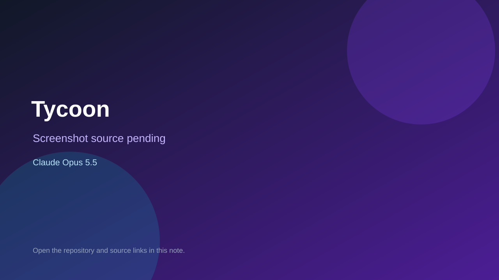

# Tycoon

> Verified game note.

## At a glance

- **Score:** 7.6/10
- **Model:** Claude Opus 5.5
- **Technology:** TypeScript, React, Browser
- **Estimated FP32 operations/s at 60 FPS:** 10,000,000 (low confidence; static estimate, not measured).
- **Rating basis:** Heuristic from source size, README and commit history (5.8 + 0.6*log10(code KB+1), +0.3 with a reachable demo); no runtime playtest.
- **Verified:** 2026-10-21
- **Repository:** [https://github.com/brightonspindoctor/Tycoon](https://github.com/brightonspindoctor/Tycoon)
- **Evidence:** [direct model evidence](https://github.com/brightonspindoctor/Tycoon/commit/f8e505cfbbd0e94f9b285bfe01ed1b47d7445954)
- **Live demo:** [open demo](https://brightonspindoctor.github.io/Tycoon/)

## Screenshots

No screenshot source is recorded yet. Keep the placeholder until a repository, awesome list, or creator source provides an image.

## Model attribution

Open the evidence link above. Evidence grade: **direct model evidence**.

## Source description

A satirical solo roguelike deckbuilder by Jonny Sadler. You run a harmful industry from the 1860s to today. Get rich, stay Chairman, and skim as much as you dare into your own fortune. The game is built so that corruption wins and doing the right thing is… Commit carries an exact Claude Opus 5.5 co-author trailer. Live demo returned HTTP 200 (availability only, not a playtest). Source inspected from README, file tree and commit history only; no playtest.

### Gameplay source

- [https://github.com/brightonspindoctor/Tycoon/blob/main/src/engine/engine.ts](https://github.com/brightonspindoctor/Tycoon/blob/main/src/engine/engine.ts)
- [https://github.com/brightonspindoctor/Tycoon/commit/f8e505cfbbd0e94f9b285bfe01ed1b47d7445954](https://github.com/brightonspindoctor/Tycoon/commit/f8e505cfbbd0e94f9b285bfe01ed1b47d7445954)

## Verification notes

- **Status:** verified_source
- **Counted units in repository:** 1
- **Units covered by this note:** 1
- **Discovery:** GitHub commit pool: model+game commits 2026-10-17T01:00Z..2026-10-21T01:00Z (1-hour Opus, 3-hour Sonnet, 6-hour other UTC partitions) joined to repositories created after 2026-10-17T00:00Z; https://github.com/brightonspindoctor/Tycoon

[Back to the awesome list](../../README.md)
