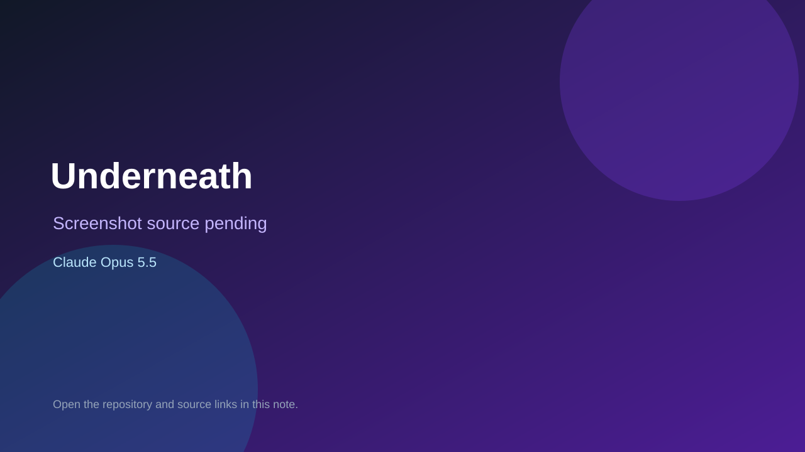

# Underneath

> Verified game note.

## At a glance

- **Score:** 7.5/10
- **Model:** Claude Opus 5.5
- **Technology:** TypeScript, Browser
- **Estimated FP32 operations/s at 60 FPS:** 100,000,000 (low confidence; static estimate, not measured).
- **Rating basis:** Heuristic from source size, README and commit history (5.8 + 0.6*log10(code KB+1), +0.3 with a reachable demo); no runtime playtest.
- **Verified:** 2026-10-16
- **Repository:** [https://github.com/MundaPlus/Underneath](https://github.com/MundaPlus/Underneath)
- **Evidence:** [direct model evidence](https://github.com/MundaPlus/Underneath/commit/9013185dda4414ef7edaa2e7073c64d13d12222f)
- **Live demo:** [open demo](https://mundaplus.github.io/Underneath/)

## Screenshots

No screenshot source is recorded yet. Keep the placeholder until a repository, awesome list, or creator source provides an image.

## Model attribution

Open the evidence link above. Evidence grade: **direct model evidence**.

## Source description

Incremental idle game with plug-in themes (Fungal Network, Clockwork Afterlife and a dream theme) sharing one rules engine. Commit carries an exact Claude Opus 5.5 co-author trailer. Live demo returned HTTP 200 (availability only, not a playtest). Source inspected only; no playtest.

### Gameplay source

- [https://github.com/MundaPlus/Underneath/blob/master/src/themes/clockwork/renderer.ts](https://github.com/MundaPlus/Underneath/blob/master/src/themes/clockwork/renderer.ts)
- [https://github.com/MundaPlus/Underneath/commit/9013185dda4414ef7edaa2e7073c64d13d12222f](https://github.com/MundaPlus/Underneath/commit/9013185dda4414ef7edaa2e7073c64d13d12222f)

## Verification notes

- **Status:** verified_source
- **Counted units in repository:** 1
- **Units covered by this note:** 1
- **Discovery:** GitHub commit pool: model+game commits 2026-10-15..2026-10-16 (6-hour UTC partitions) joined to repositories created after 2026-10-14T17:00Z; https://github.com/MundaPlus/Underneath

[Back to the awesome list](../../README.md)
