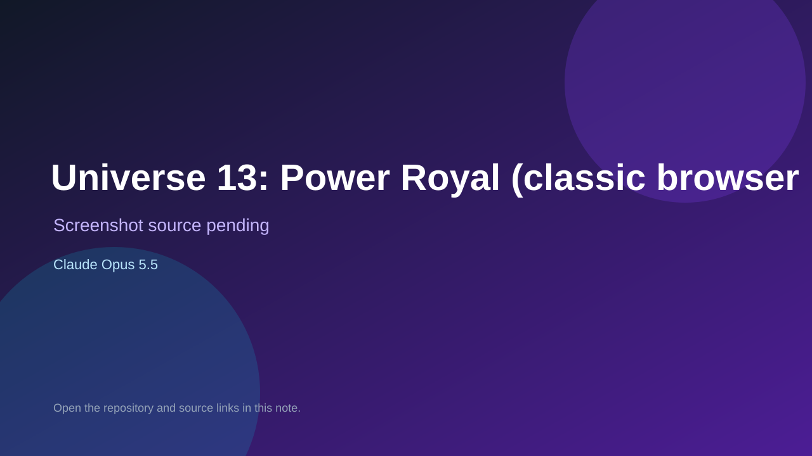

# Universe 13: Power Royal (classic browser game)

> Verified game note.

## At a glance

- **Score:** 8.4/10
- **Model:** Claude Opus 5.5
- **Technology:** JavaScript, Three.js, Browser
- **Estimated FP32 operations/s at 60 FPS:** 1,000,000,000 (low confidence; static estimate, not measured).
- **Rating basis:** Heuristic from source size, README and commit history (5.8 + 0.6*log10(code KB+1), +0.3 with a reachable demo); no runtime playtest.
- **Verified:** 2026-10-21
- **Repository:** [https://github.com/ssjtheoryali/universe13-classic](https://github.com/ssjtheoryali/universe13-classic)
- **Evidence:** [direct model evidence](https://github.com/ssjtheoryali/universe13-classic/commit/b6b9850a307f77bec8b6a54e296ac5b30390cb88)
- **Live demo:** [open demo](https://ssjtheoryali.github.io/universe13-classic/)
- **Additional live link:** [open demo](https://ssjtheoryali.github.io/universe13/)
- **Additional live link:** [open demo](https://ssjtheoryali.github.io/universe13-story/)

## Screenshots

No screenshot source is recorded yet. Keep the placeholder until a repository, awesome list, or creator source provides an image.

## Model attribution

Open the evidence link above. Evidence grade: **direct model evidence**.

## Source description

Universe 13: classic three.js browser game (GitHub Pages). Commit carries an exact Claude Opus 5.5 co-author trailer. Live demo returned HTTP 200 (availability only, not a playtest). Source inspected from README, file tree and commit history only; no playtest.

### Gameplay source

- [https://github.com/ssjtheoryali/universe13-classic/blob/main/js/legacy/u13.legacy.js](https://github.com/ssjtheoryali/universe13-classic/blob/main/js/legacy/u13.legacy.js)
- [https://github.com/ssjtheoryali/universe13-classic/commit/b6b9850a307f77bec8b6a54e296ac5b30390cb88](https://github.com/ssjtheoryali/universe13-classic/commit/b6b9850a307f77bec8b6a54e296ac5b30390cb88)

## Verification notes

- **Status:** verified_source
- **Counted units in repository:** 1
- **Units covered by this note:** 1
- **Discovery:** GitHub commit pool: model+game commits 2026-10-17T01:00Z..2026-10-21T01:00Z (1-hour Opus, 3-hour Sonnet, 6-hour other UTC partitions) joined to repositories created after 2026-10-17T00:00Z; https://github.com/ssjtheoryali/universe13-classic

[Back to the awesome list](../../README.md)
