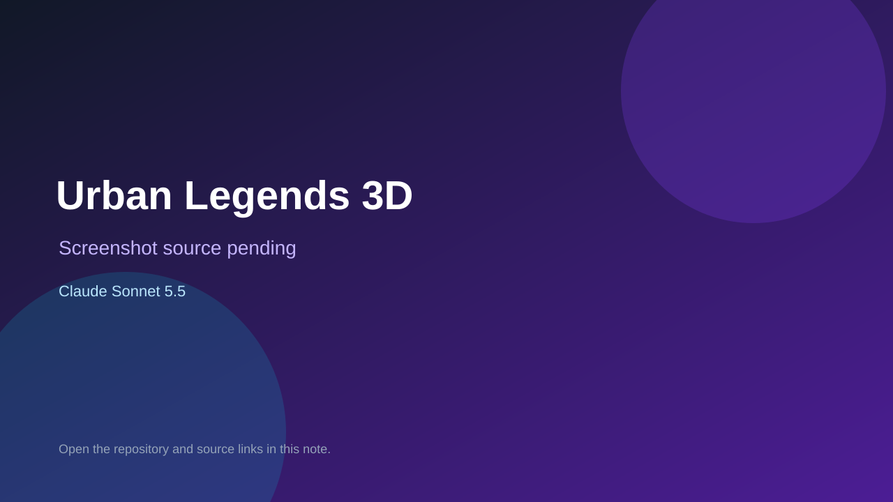

# Urban Legends 3D

> Verified game note.

## At a glance

- **Score:** 7.3/10
- **Model:** Claude Sonnet 5.5
- **Technology:** TypeScript, Three.js, React, Browser
- **Estimated FP32 operations/s at 60 FPS:** 1,000,000,000 (low confidence; static estimate, not measured).
- **Rating basis:** Heuristic from source size, README and commit history (5.8 + 0.6*log10(code KB+1), +0.3 with a reachable demo); no runtime playtest.
- **Verified:** 2026-10-23
- **Repository:** [https://github.com/okankwu/urban-legends-3d](https://github.com/okankwu/urban-legends-3d)
- **Evidence:** [direct model evidence](https://github.com/okankwu/urban-legends-3d/commit/0962af488c1135dece106782a6b11f442ae48c1e)

## Screenshots

No screenshot source is recorded yet. Keep the placeholder until a repository, awesome list, or creator source provides an image.

## Model attribution

Open the evidence link above. Evidence grade: **direct model evidence**.

## Source description

Urban Legends 3D - a GTA-inspired open-world browser game (React, Three.js, Rapier). Commit carries an exact Claude Sonnet 5.5 co-author trailer. Source inspected from README, file tree and commit history only; no playtest.

### Gameplay source

- [https://github.com/okankwu/urban-legends-3d/blob/main/src/vehicles/Car.tsx](https://github.com/okankwu/urban-legends-3d/blob/main/src/vehicles/Car.tsx)
- [https://github.com/okankwu/urban-legends-3d/commit/0962af488c1135dece106782a6b11f442ae48c1e](https://github.com/okankwu/urban-legends-3d/commit/0962af488c1135dece106782a6b11f442ae48c1e)

## Verification notes

- **Status:** verified_source
- **Counted units in repository:** 1
- **Units covered by this note:** 1
- **Discovery:** GitHub commit pool: model+game commits 2026-10-21T01:00Z..2026-10-23T01:00Z (20-minute Opus 5.5 and wider other-model UTC partitions) joined to repositories created after 2026-10-20T01:00Z; https://github.com/okankwu/urban-legends-3d

[Back to the awesome list](../../README.md)
