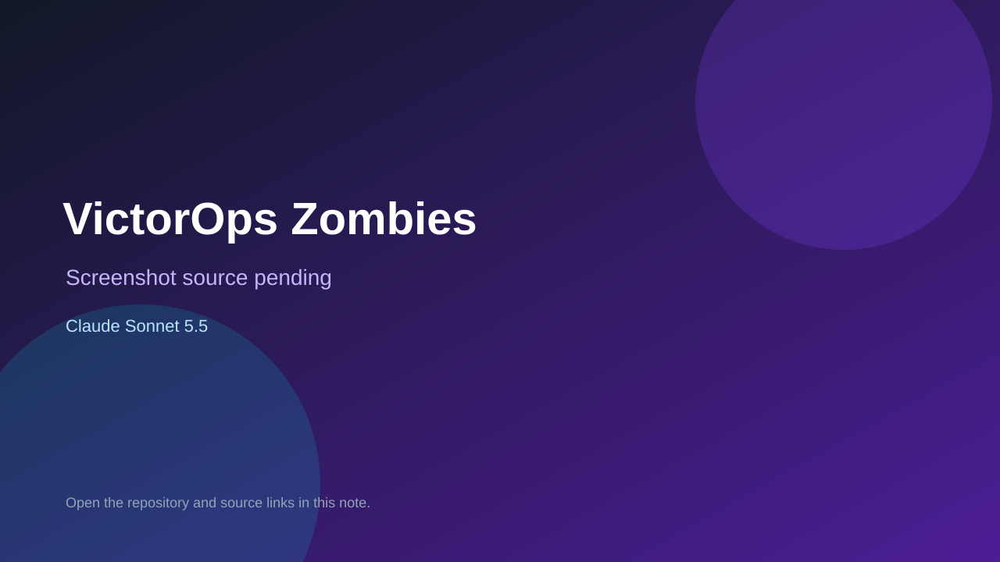

# VictorOps Zombies

> Verified game note.

## At a glance

- **Score:** 6.9/10
- **Model:** Claude Sonnet 5.5
- **Technology:** Kotlin
- **Estimated FP32 operations/s at 60 FPS:** 1,000,000 (low confidence; static estimate, not measured).
- **Rating basis:** Heuristic from source size, README and commit history (5.8 + 0.6*log10(code KB+1), +0.3 with a reachable demo); no runtime playtest.
- **Verified:** 2026-10-23
- **Repository:** [https://github.com/Victorious93/victorops-zombies](https://github.com/Victorious93/victorops-zombies)
- **Evidence:** [direct model evidence](https://github.com/Victorious93/victorops-zombies/commit/ed540dc030483acc578b91d016031f89865d02a1)

## Screenshots

No screenshot source is recorded yet. Keep the placeholder until a repository, awesome list, or creator source provides an image.

## Model attribution

Open the evidence link above. Evidence grade: **direct model evidence**.

## Source description

VictorOps Zombies: original wave-survival zombie game for Android (libGDX/Kotlin). Commit carries an exact Claude Sonnet 5.5 co-author trailer. Source inspected from README, file tree and commit history only; no playtest.

### Gameplay source

- [https://github.com/Victorious93/victorops-zombies/blob/main/core/src/main/kotlin/com/victorious/zombie/sim/World.kt](https://github.com/Victorious93/victorops-zombies/blob/main/core/src/main/kotlin/com/victorious/zombie/sim/World.kt)
- [https://github.com/Victorious93/victorops-zombies/commit/ed540dc030483acc578b91d016031f89865d02a1](https://github.com/Victorious93/victorops-zombies/commit/ed540dc030483acc578b91d016031f89865d02a1)

## Verification notes

- **Status:** verified_source
- **Counted units in repository:** 1
- **Units covered by this note:** 1
- **Discovery:** GitHub commit pool: model+game commits 2026-10-21T01:00Z..2026-10-23T01:00Z (20-minute Opus 5.5 and wider other-model UTC partitions) joined to repositories created after 2026-10-20T01:00Z; https://github.com/Victorious93/victorops-zombies

[Back to the awesome list](../../README.md)
