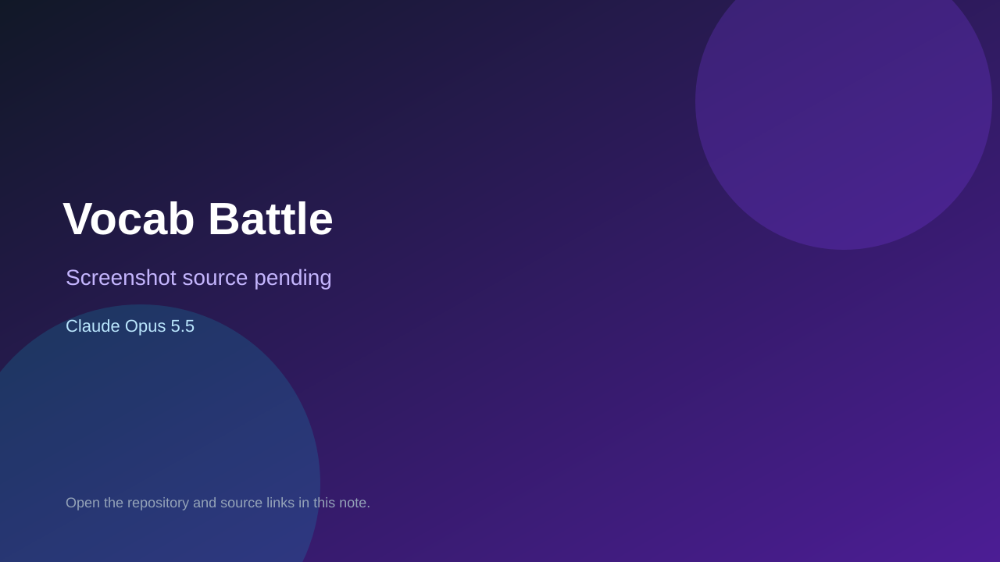

# Vocab Battle

> Verified game note.

## At a glance

- **Score:** 7.2/10
- **Model:** Claude Opus 5.5
- **Technology:** TypeScript, React, Browser
- **Estimated FP32 operations/s at 60 FPS:** 10,000,000 (low confidence; static estimate, not measured).
- **Rating basis:** Heuristic from source size, README and commit history (5.8 + 0.6*log10(code KB+1), +0.3 with a reachable demo); no runtime playtest.
- **Verified:** 2026-10-23
- **Repository:** [https://github.com/vanchien2973/vocab-battle](https://github.com/vanchien2973/vocab-battle)
- **Evidence:** [direct model evidence](https://github.com/vanchien2973/vocab-battle/commit/34dadefd2d9766f0ddd0a56c907f2983b662d896)

## Screenshots

No screenshot source is recorded yet. Keep the placeholder until a repository, awesome list, or creator source provides an image.

## Model attribution

Open the evidence link above. Evidence grade: **direct model evidence**.

## Source description

Game đấu từ vựng Anh–Việt: mỗi lượt có 1 từ tiếng Anh và 4 nghĩa tiếng Việt. Ai trả lời đúng và nhanh hơn sẽ gây sát thương cho đối thủ; trả lời đúng liên tiếp tạo combo, sát thương tăng dần. Mỗi bên có 100 HP. Commit carries an exact Claude Opus 5.5 co-author trailer. Source inspected from README, file tree and commit history only; no playtest.

### Gameplay source

- [https://github.com/vanchien2973/vocab-battle/blob/main/src/components/OnlineGame.tsx](https://github.com/vanchien2973/vocab-battle/blob/main/src/components/OnlineGame.tsx)
- [https://github.com/vanchien2973/vocab-battle/commit/34dadefd2d9766f0ddd0a56c907f2983b662d896](https://github.com/vanchien2973/vocab-battle/commit/34dadefd2d9766f0ddd0a56c907f2983b662d896)

## Verification notes

- **Status:** verified_source
- **Counted units in repository:** 1
- **Units covered by this note:** 1
- **Discovery:** GitHub commit pool: model+game commits 2026-10-21T01:00Z..2026-10-23T01:00Z (20-minute Opus 5.5 and wider other-model UTC partitions) joined to repositories created after 2026-10-20T01:00Z; https://github.com/vanchien2973/vocab-battle

[Back to the awesome list](../../README.md)
