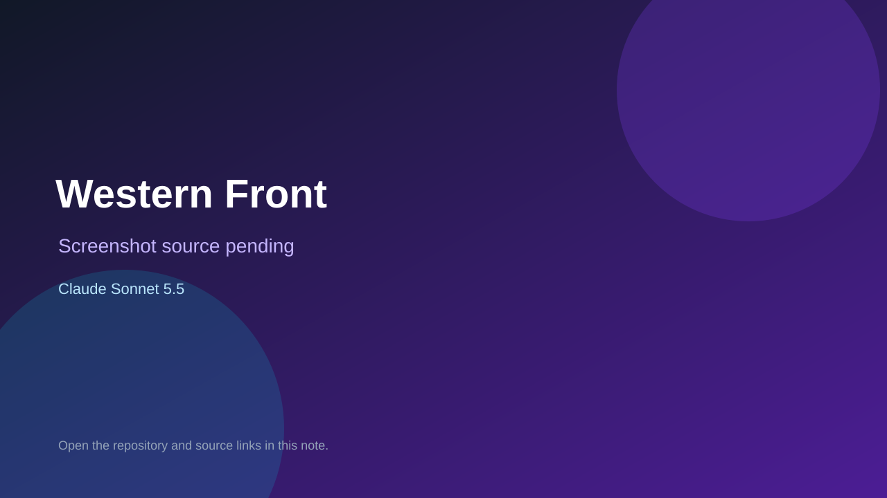

# Western Front

> Verified game note.

## At a glance

- **Score:** 7.1/10
- **Model:** Claude Sonnet 5.5
- **Technology:** JavaScript, Browser
- **Estimated FP32 operations/s at 60 FPS:** 100,000,000 (low confidence; static estimate, not measured).
- **Rating basis:** Heuristic from source size, README and commit history (5.8 + 0.6*log10(code KB+1), +0.3 with a reachable demo); no runtime playtest.
- **Verified:** 2026-10-23
- **Repository:** [https://github.com/zrsavage/Trenchwarfare](https://github.com/zrsavage/Trenchwarfare)
- **Evidence:** [direct model evidence](https://github.com/zrsavage/Trenchwarfare/commit/ea5b749525da49dfefae69df550216ec187daaf6)

## Screenshots

No screenshot source is recorded yet. Keep the placeholder until a repository, awesome list, or creator source provides an image.

## Model attribution

Open the evidence link above. Evidence grade: **direct model evidence**.

## Source description

A turn-based strategy game about the stalemate on the Western Front in World War I. You command the Allied side against a computer-controlled German army. The rules are built so students discover the central paradox of trench warfare by playing: digging in is… Commit carries an exact Claude Sonnet 5.5 co-author trailer. Source inspected from README, file tree and commit history only; no playtest.

### Gameplay source

- [https://github.com/zrsavage/Trenchwarfare/blob/claude/trench-warfare-game-design-n4l25i/js/render.js](https://github.com/zrsavage/Trenchwarfare/blob/claude/trench-warfare-game-design-n4l25i/js/render.js)
- [https://github.com/zrsavage/Trenchwarfare/commit/ea5b749525da49dfefae69df550216ec187daaf6](https://github.com/zrsavage/Trenchwarfare/commit/ea5b749525da49dfefae69df550216ec187daaf6)

## Verification notes

- **Status:** verified_source
- **Counted units in repository:** 1
- **Units covered by this note:** 1
- **Discovery:** GitHub commit pool: model+game commits 2026-10-21T01:00Z..2026-10-23T01:00Z (20-minute Opus 5.5 and wider other-model UTC partitions) joined to repositories created after 2026-10-20T01:00Z; https://github.com/zrsavage/Trenchwarfare

[Back to the awesome list](../../README.md)
