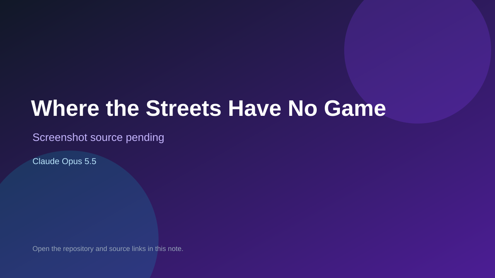

# Where the Streets Have No Game

> Verified game note.

## At a glance

- **Score:** 7.4/10
- **Model:** Claude Opus 5.5
- **Technology:** JavaScript, Browser
- **Estimated FP32 operations/s at 60 FPS:** 50,000,000 (low confidence; static estimate, not measured).
- **Rating basis:** Estimated from README, source tree and commit history; no runtime playtest.
- **Verified:** 2026-10-15
- **Repository:** [https://github.com/joshuamcginley-lab/where-the-streets-have-no-game](https://github.com/joshuamcginley-lab/where-the-streets-have-no-game)
- **Evidence:** [direct model evidence](https://github.com/joshuamcginley-lab/where-the-streets-have-no-game/commit/43950c7939d7a3736941a2539563cb77f6644243)

## Screenshots

No screenshot source is recorded yet. Keep the placeholder until a repository, awesome list, or creator source provides an image.

## Model attribution

Open the evidence link above. Evidence grade: **direct model evidence**.

## Source description

Jackbox-style U2 trivia party game: TV shows questions, 1-4 players answer on phones with characters and running scores; Claude Opus 5.5 trailers. Source inspected only; no playtest.

### Gameplay source

- [https://github.com/joshuamcginley-lab/where-the-streets-have-no-game/blob/main/covers.js](https://github.com/joshuamcginley-lab/where-the-streets-have-no-game/blob/main/covers.js)
- [https://github.com/joshuamcginley-lab/where-the-streets-have-no-game/commit/43950c7939d7a3736941a2539563cb77f6644243](https://github.com/joshuamcginley-lab/where-the-streets-have-no-game/commit/43950c7939d7a3736941a2539563cb77f6644243)

## Verification notes

- **Status:** verified_source
- **Counted units in repository:** 1
- **Units covered by this note:** 1
- **Discovery:** GitHub commit pool: model+game commits 2026-10-08..2026-10-15 joined to repositories created after 2026-10-07T17:00Z; https://github.com/joshuamcginley-lab/where-the-streets-have-no-game

[Back to the awesome list](../../README.md)
