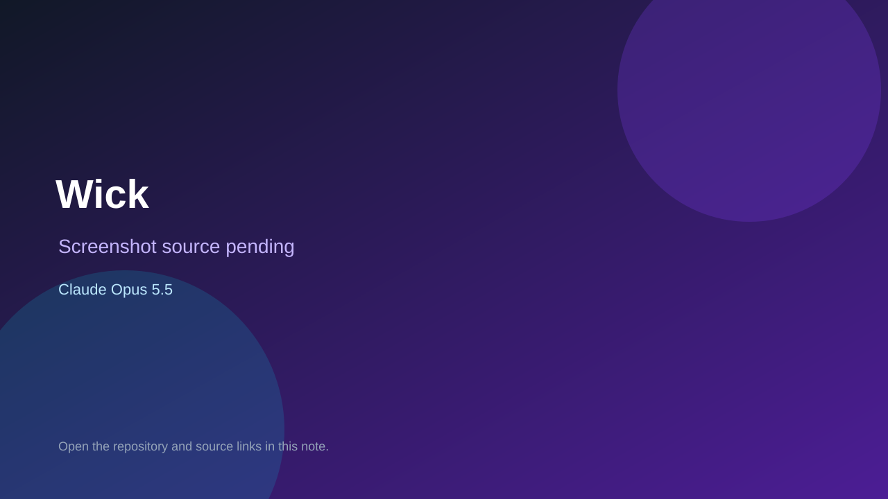

# Wick

> Verified game note.

## At a glance

- **Score:** 7.6/10
- **Model:** Claude Opus 5.5
- **Technology:** C#, Browser
- **Estimated FP32 operations/s at 60 FPS:** 10,000,000 (low confidence; static estimate, not measured).
- **Rating basis:** Heuristic from source size, README and commit history (5.8 + 0.6*log10(code KB+1), +0.3 with a reachable demo); no runtime playtest.
- **Verified:** 2026-10-21
- **Repository:** [https://github.com/UpriseStudios/Wick](https://github.com/UpriseStudios/Wick)
- **Evidence:** [direct model evidence](https://github.com/UpriseStudios/Wick/commit/8184e1451597b5511f9dd48b38e95cec226aafcf)

## Screenshots

No screenshot source is recorded yet. Keep the placeholder until a repository, awesome list, or creator source provides an image.

## Model attribution

Open the evidence link above. Evidence grade: **direct model evidence**.

## Source description

Mobile build-and-raid game: build trap vaults, raid other players' vaults as Wick,. Commit carries an exact Claude Opus 5.5 co-author trailer. Source inspected from README, file tree and commit history only; no playtest.

### Gameplay source

- [https://github.com/UpriseStudios/Wick/blob/main/web/.wrangler/tmp/pages-7ZgcBS/functionsWorker-0.513567054685355.js](https://github.com/UpriseStudios/Wick/blob/main/web/.wrangler/tmp/pages-7ZgcBS/functionsWorker-0.513567054685355.js)
- [https://github.com/UpriseStudios/Wick/commit/8184e1451597b5511f9dd48b38e95cec226aafcf](https://github.com/UpriseStudios/Wick/commit/8184e1451597b5511f9dd48b38e95cec226aafcf)

## Verification notes

- **Status:** verified_source
- **Counted units in repository:** 1
- **Units covered by this note:** 1
- **Discovery:** GitHub commit pool: model+game commits 2026-10-17T01:00Z..2026-10-21T01:00Z (1-hour Opus, 3-hour Sonnet, 6-hour other UTC partitions) joined to repositories created after 2026-10-17T00:00Z; https://github.com/UpriseStudios/Wick

[Back to the awesome list](../../README.md)
