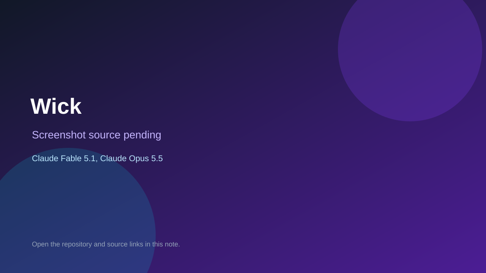

# Wick

> Verified game note.

## At a glance

- **Score:** 7.8/10
- **Model:** Claude Fable 5.1, Claude Opus 5.5
- **Technology:** Swift, iOS, Browser
- **Estimated FP32 operations/s at 60 FPS:** 50,000,000 (low confidence; static estimate, not measured).
- **Rating basis:** Estimated from README, source tree and commit history; no runtime playtest.
- **Verified:** 2026-10-15
- **Repository:** [https://github.com/jasonepage/Wick](https://github.com/jasonepage/Wick)
- **Evidence:** [direct model evidence](https://github.com/jasonepage/Wick/commit/d3391f7d6074f1798bb07d13cdcda797d92e2639)
- **Live demo:** [open demo](https://guesswick.com)

## Screenshots

No screenshot source is recorded yet. Keep the placeholder until a repository, awesome list, or creator source provides an image.

## Model attribution

Open the evidence link above. Evidence grade: **direct model evidence**.

## Source description

Daily word game where you guess the secret word by meaning, not spelling; iOS app, web client and scoring server; Claude Fable 5.1 and Opus 5.5 trailers. Live demo returned HTTP 200 (availability only, not a playtest). Source inspected only; no playtest.

### Gameplay source

- [https://github.com/jasonepage/Wick/blob/main/Hunch/ContentView.swift](https://github.com/jasonepage/Wick/blob/main/Hunch/ContentView.swift)
- [https://github.com/jasonepage/Wick/commit/d3391f7d6074f1798bb07d13cdcda797d92e2639](https://github.com/jasonepage/Wick/commit/d3391f7d6074f1798bb07d13cdcda797d92e2639)

## Verification notes

- **Status:** verified_source_and_live_demo
- **Counted units in repository:** 1
- **Units covered by this note:** 1
- **Discovery:** GitHub commit pool: model+game commits 2026-10-08..2026-10-15 joined to repositories created after 2026-10-07T17:00Z; https://github.com/jasonepage/Wick

[Back to the awesome list](../../README.md)
