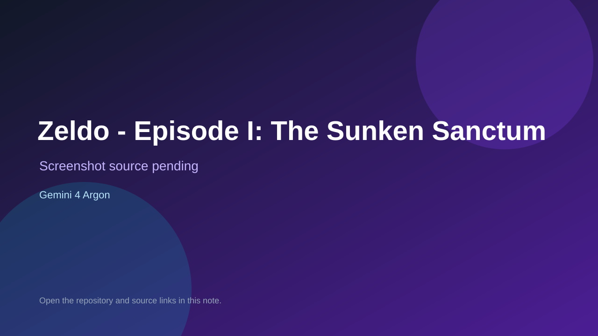

# Zeldo - Episode I: The Sunken Sanctum

> Top-list entry: **this week** (#6), **this month** (#12).

## At a glance

- **Score:** 8.3/10
- **Model:** Gemini 4 Argon
- **Technology:** Next.js, React, TypeScript, Babylon.js, Zustand, Web Audio API, Browser
- **Estimated FP32 operations/s at 60 FPS:** 500,000,000 (low confidence; static estimate, not measured).
- **Rating basis:** Documented playable adventure with combat, economy, two maps, boss and win state plus editor; no runtime playtest.
- **Verified:** 2026-10-14
- **Repository:** [https://github.com/EBIKEBUILDER/zeldo-argon](https://github.com/EBIKEBUILDER/zeldo-argon)
- **Evidence:** [creator-reported model evidence](https://github.com/EBIKEBUILDER/zeldo-argon)
- **Live demo:** [open demo](https://zeldo-argon.vercel.app)

## Screenshots

No screenshot source is recorded yet. Keep the placeholder until a repository, awesome list, or creator source provides an image.

## Model attribution

Open the evidence link above. Evidence grade: **creator-reported model evidence**.

## Source description

Repository description states zelda clone with gemini 4 argon. README documents a playable overhead 3D action-adventure: movement, sword, shield, boomerang, bow, shop economy, overworld plus dungeon maps, locked gates, boss Malakor with stun mechanic and crest win state, plus a 3D map editor. src/game, src/components, src/store present. Model claim lives in the repository description; README body and commit trailers do not repeat it. Source inspected only; no playtest.

### Gameplay source

- [https://github.com/EBIKEBUILDER/zeldo-argon/blob/main/src/app/page.tsx](https://github.com/EBIKEBUILDER/zeldo-argon/blob/main/src/app/page.tsx)
- [https://github.com/EBIKEBUILDER/zeldo-argon](https://github.com/EBIKEBUILDER/zeldo-argon)

## Verification notes

- **Status:** verified_source
- **Counted units in repository:** 1
- **Units covered by this note:** 1
- **Discovery:** GitHub repository search for gemini-4-argon; https://github.com/EBIKEBUILDER/zeldo-argon

[Back to the awesome list](../../README.md)
