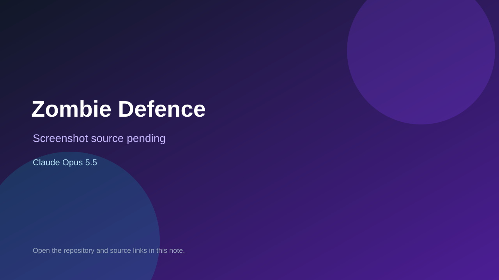

# Zombie Defence

> Verified game note.

## At a glance

- **Score:** 7.8/10
- **Model:** Claude Opus 5.5
- **Technology:** TypeScript, Browser
- **Estimated FP32 operations/s at 60 FPS:** 1,000,000,000 (low confidence; static estimate, not measured).
- **Rating basis:** Heuristic from source size, README and commit history (5.8 + 0.6*log10(code KB+1), +0.3 with a reachable demo); no runtime playtest.
- **Verified:** 2026-10-21
- **Repository:** [https://github.com/Hydroponicz/zombiedefence](https://github.com/Hydroponicz/zombiedefence)
- **Evidence:** [direct model evidence](https://github.com/Hydroponicz/zombiedefence/commit/73e3c96e87a5f178586d056206cbce3e8af1839b)
- **Live demo:** [open demo](https://zombiedefence-two.vercel.app)

## Screenshots

No screenshot source is recorded yet. Keep the placeholder until a repository, awesome list, or creator source provides an image.

## Model attribution

Open the evidence link above. Evidence grade: **direct model evidence**.

## Source description

A 3D browser sandbox where a city falls to a zombie outbreak in real time and you fly the. Commit carries an exact Claude Opus 5.5 co-author trailer. Live demo returned HTTP 200 (availability only, not a playtest). Source inspected from README, file tree and commit history only; no playtest.

### Gameplay source

- [https://github.com/Hydroponicz/zombiedefence/blob/main/src/world/City.ts](https://github.com/Hydroponicz/zombiedefence/blob/main/src/world/City.ts)
- [https://github.com/Hydroponicz/zombiedefence/commit/73e3c96e87a5f178586d056206cbce3e8af1839b](https://github.com/Hydroponicz/zombiedefence/commit/73e3c96e87a5f178586d056206cbce3e8af1839b)

## Verification notes

- **Status:** verified_source
- **Counted units in repository:** 1
- **Units covered by this note:** 1
- **Discovery:** GitHub commit pool: model+game commits 2026-10-17T01:00Z..2026-10-21T01:00Z (1-hour Opus, 3-hour Sonnet, 6-hour other UTC partitions) joined to repositories created after 2026-10-17T00:00Z; https://github.com/Hydroponicz/zombiedefence

[Back to the awesome list](../../README.md)
