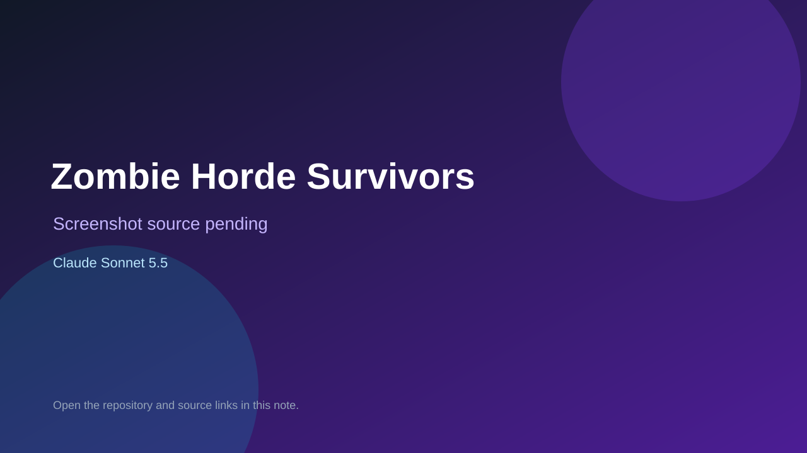

# Zombie Horde Survivors

> Top-list entry: **this week** (#14).

## At a glance

- **Score:** 8.0/10
- **Model:** Claude Sonnet 5.5
- **Technology:** JavaScript, Three.js, Browser
- **Estimated FP32 operations/s at 60 FPS:** 1,000,000,000 (low confidence; static estimate, not measured).
- **Rating basis:** Estimated from README, source tree and commit history; no runtime playtest.
- **Verified:** 2026-10-15
- **Repository:** [https://github.com/agustindiazcano/zombie-horde-survivors](https://github.com/agustindiazcano/zombie-horde-survivors)
- **Evidence:** [direct model evidence](https://github.com/agustindiazcano/zombie-horde-survivors/commit/3018b40a6f1ef047583c6c960409bc5d2098c957)
- **Live demo:** [open demo](https://agustindiazcano.github.io/zombie-horde-survivors/)

## Screenshots

No screenshot source is recorded yet. Keep the placeholder until a repository, awesome list, or creator source provides an image.

## Model attribution

Open the evidence link above. Evidence grade: **direct model evidence**.

## Source description

Browser 3D squad shooter against waves of zombies, skeletons, aliens and worms with hands-on and command modes; Claude Sonnet 5.5 trailers on 88 commits. Live demo returned HTTP 200 (availability only, not a playtest). Source inspected only; no playtest.

### Gameplay source

- [https://github.com/agustindiazcano/zombie-horde-survivors/blob/main/eslint.config.js](https://github.com/agustindiazcano/zombie-horde-survivors/blob/main/eslint.config.js)
- [https://github.com/agustindiazcano/zombie-horde-survivors/commit/3018b40a6f1ef047583c6c960409bc5d2098c957](https://github.com/agustindiazcano/zombie-horde-survivors/commit/3018b40a6f1ef047583c6c960409bc5d2098c957)

## Verification notes

- **Status:** verified_source_and_live_demo
- **Counted units in repository:** 1
- **Units covered by this note:** 1
- **Discovery:** GitHub commit pool: model+game commits 2026-10-08..2026-10-15 joined to repositories created after 2026-10-07T17:00Z; https://github.com/agustindiazcano/zombie-horde-survivors

[Back to the awesome list](../../README.md)
