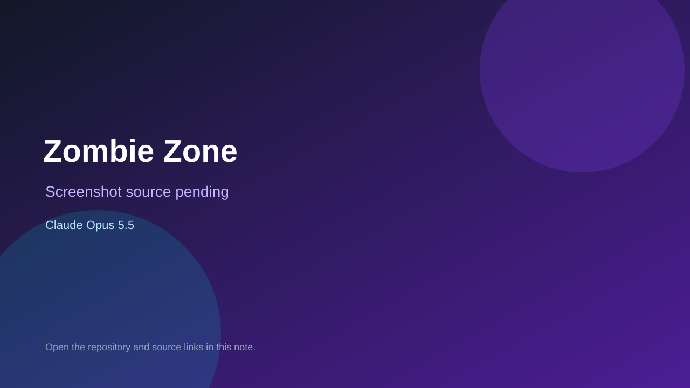

# Zombie Zone

> Verified game note.

## At a glance

- **Score:** 7.5/10
- **Model:** Claude Opus 5.5
- **Technology:** Godot, GDScript
- **Estimated FP32 operations/s at 60 FPS:** 600,000,000 (low confidence; static estimate, not measured).
- **Rating basis:** Estimated from README, source tree and commit history; no runtime playtest.
- **Verified:** 2026-10-15
- **Repository:** [https://github.com/zees-games/game-zombie-zone](https://github.com/zees-games/game-zombie-zone)
- **Evidence:** [direct model evidence](https://github.com/zees-games/game-zombie-zone/commit/a2ee573be1a097607583a6785ea5d43874aadaef)

## Screenshots

No screenshot source is recorded yet. Keep the placeholder until a repository, awesome list, or creator source provides an image.

## Model attribution

Open the evidence link above. Evidence grade: **direct model evidence**.

## Source description

3D team zombie game built on Godot 4 to demonstrate the Dot asset collection and the Modding Community play platform; all 58 commits co-author Claude Opus 5.5. Source inspected only; no playtest.

### Gameplay source

- [https://github.com/zees-games/game-zombie-zone/blob/main/examples/dedicated.gd](https://github.com/zees-games/game-zombie-zone/blob/main/examples/dedicated.gd)
- [https://github.com/zees-games/game-zombie-zone/commit/a2ee573be1a097607583a6785ea5d43874aadaef](https://github.com/zees-games/game-zombie-zone/commit/a2ee573be1a097607583a6785ea5d43874aadaef)

## Verification notes

- **Status:** verified_source
- **Counted units in repository:** 1
- **Units covered by this note:** 1
- **Discovery:** GitHub commit pool: model+game commits 2026-10-08..2026-10-15 joined to repositories created after 2026-10-07T17:00Z; https://github.com/zees-games/game-zombie-zone

[Back to the awesome list](../../README.md)
