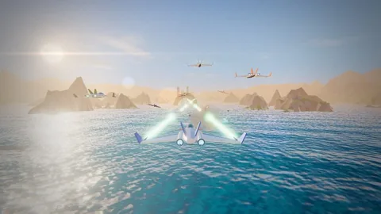

# 🎮 Awesome AI Games

### 2185 curated game units. 1878 qualifying source repositories.

  

 

> **Browse source-backed games attributed to GPT-6 Astra, GPT-6.1 Sol, Gemini 4 Argon, Claude Opus, Claude Sonnet, or Claude Fable.** 
> Every listed unit maps to a qualifying GitHub source repository. The model-evidence grade is visible on every entry.

---

## Top games by screenshot

Rank 30 games by the score of each game's best manually reviewed screenshot, not by source-quality score. Review composition, scene detail, visual coherence, and readable gameplay. Reward polished stylized art as well as realism; discount title cards, menus, concept art, and frames that do not show play. Treat this as a visual impression, not a runtime playtest or proof of AAA production quality. Select a thumbnail or title to inspect every image's score, rating method, and reason on the game's Markdown page. Secondary images use relative frame adjustments, not independent manual reviews.

<table>
<tr>
<td align="center" width="33%"> <a href="../games/turbo-kart-rally/readme.md"><strong>Turbo Kart Rally</strong></a> · 📸 9.8/10</td>
<td align="center" width="33%"> <a href="../games/neural-sight/readme.md"><strong>Neural Sight</strong></a> · 📸 9.7/10</td>
<td align="center" width="33%"> <a href="../games/kart-royale/readme.md"><strong>Kart Royale</strong></a> · 📸 9.5/10</td>
</tr>
<tr>
<td align="center" width="33%"> <a href="../games/nerd-of-duty/readme.md"><strong>Nerd of Duty</strong></a> · 📸 9.4/10</td>
<td align="center" width="33%"> <a href="../games/vector-rush/readme.md"><strong>VECTOR RUSH</strong></a> · 📸 9.3/10</td>
<td align="center" width="33%"> <a href="../games/turbo-kart-grand-prix/readme.md"><strong>Turbo Kart Grand Prix</strong></a> · 📸 9.2/10</td>
</tr>
<tr>
<td align="center" width="33%"> <a href="../games/iridium-reach/readme.md"><strong>Iridium Reach</strong></a> · 📸 9.0/10</td>
<td align="center" width="33%"> <a href="../games/silent-meridian/readme.md"><strong>Silent Meridian</strong></a> · 📸 9.0/10</td>
<td align="center" width="33%"> <a href="../games/world-of-claudecraft/readme.md"><strong>World of ClaudeCraft</strong></a> · 📸 9.0/10</td>
</tr>
<tr>
<td align="center" width="33%"> <a href="../games/kindle/readme.md"><strong>KINDLE</strong></a> · 📸 8.9/10</td>
<td align="center" width="33%"> <a href="../games/sunbreak-downhill-club/readme.md"><strong>SUNBREAK — Downhill Club</strong></a> · 📸 8.9/10</td>
<td align="center" width="33%"> <a href="../games/fishslop/readme.md"><strong>Fishslop</strong></a> · 📸 8.8/10</td>
</tr>
<tr>
<td align="center" width="33%"> <a href="../games/overrun-dockyard-nine/readme.md"><strong>OVERRUN: Dockyard Nine</strong></a> · 📸 8.8/10</td>
<td align="center" width="33%"> <a href="../games/fall-line/readme.md"><strong>Fall Line</strong></a> · 📸 8.7/10</td>
<td align="center" width="33%"> <a href="../games/little-flock/readme.md"><strong>Little Flock · 小羊慢慢</strong></a> · 📸 8.7/10</td>
</tr>
<tr>
<td align="center" width="33%"> <a href="../games/the-hourglass-city/readme.md"><strong>The Hourglass City</strong></a> · 📸 8.7/10</td>
<td align="center" width="33%"> <a href="../games/turbo-kart-rush/readme.md"><strong>Turbo Kart Rush</strong></a> · 📸 8.7/10</td>
<td align="center" width="33%"> <a href="../games/turbo-kart-rush-claudio41cg-max-rio-rush-cross/readme.md"><strong>Turbo Kart Rush</strong></a> · 📸 8.7/10</td>
</tr>
<tr>
<td align="center" width="33%"> <a href="../games/rally-navigator/readme.md"><strong>Rally Navigator</strong></a> · 📸 8.6/10</td>
<td align="center" width="33%"> <a href="../games/rogue-squadron-the-battle-of-yavin/readme.md"><strong>Rogue Squadron — The Battle of Yavin</strong></a> · 📸 8.6/10</td>
<td align="center" width="33%"> <a href="../games/clawd-pop-3d/readme.md"><strong>Clawd Pop 3D</strong></a> · 📸 8.5/10</td>
</tr>
<tr>
<td align="center" width="33%"> <a href="../games/the-black-sedan/readme.md"><strong>The Black Sedan</strong></a> · 📸 8.5/10</td>
<td align="center" width="33%"> <a href="../games/luma-the-garden-of-light/readme.md"><strong>LUMA — The Garden of Light</strong></a> · 📸 8.3/10</td>
<td align="center" width="33%"> <a href="../games/barista-shift/readme.md"><strong>Barista Shift</strong></a> · 📸 8.2/10</td>
</tr>
<tr>
<td align="center" width="33%"> <a href="../games/nova-lancer/readme.md"><strong>Nova Lancer</strong></a> · 📸 8.2/10</td>
<td align="center" width="33%"> <a href="../games/operation-ironhold/readme.md"><strong>Operation Ironhold</strong></a> · 📸 8.2/10</td>
<td align="center" width="33%"> <a href="../games/saber-descent/readme.md"><strong>Saber / Descent</strong></a> · 📸 8.2/10</td>
</tr>
<tr>
<td align="center" width="33%"> <a href="../games/tater-s-flight-sim/readme.md"><strong>Tater's Flight Sim</strong></a> · 📸 8.2/10</td>
<td align="center" width="33%"> <a href="../games/buildyourtown/readme.md"><strong>BuildYourTown</strong></a> · 📸 8.1/10</td>
<td align="center" width="33%"> <a href="../games/lumenrift/readme.md"><strong>LUMENRIFT</strong></a> · 📸 8.1/10</td>
</tr>
</table>

## Browse by model

Select a model to browse its ranked games and screenshots. Count each multi-model game on every matching model page; do not sum these counts for a collection total. Keep broad and unspecified model labels separate from versioned labels.

| Model | Game units | Source repositories |
| --- | ---: | ---: |
| [Claude Opus 5.5](../models/claude-opus-5-5.md) | **1161** | 1128 |
| [Claude Sonnet 5.5](../models/claude-sonnet-5-5.md) | **286** | 260 |
| [Claude Fable 5.1](../models/claude-fable-5-1.md) | **231** | 163 |
| [Claude Fable 5](../models/claude-fable-5.md) | **205** | 97 |
| [Claude Opus 5](../models/claude-opus-5.md) | **126** | 111 |
| [GPT-6 Astra](../models/gpt-6-astra.md) | **115** | 86 |
| [Claude Opus 4.6](../models/claude-opus-4-6.md) | **83** | 69 |
| [Claude Opus 4.8](../models/claude-opus-4-8.md) | **67** | 53 |
| [Claude Opus 4.7](../models/claude-opus-4-7.md) | **25** | 25 |
| [Gemini 4 Argon](../models/gemini-4-argon.md) | **16** | 10 |
| [Claude Opus 4.5](../models/claude-opus-4-5.md) | **13** | 13 |
| [GPT-6.1 Sol](../models/gpt-6-1-sol.md) | **13** | 13 |
| [Codex](../models/codex.md) | **7** | 7 |
| [Claude Opus](../models/claude-opus.md) | **4** | 4 |
| [Claude Opus 4](../models/claude-opus-4.md) | **4** | 2 |
| [GPT-6](../models/gpt-6.md) | **4** | 4 |
| [Claude Code](../models/claude-code.md) | **2** | 2 |
| [ChatGPT 5.6 Soul](../models/chatgpt-5-6-soul.md) | **1** | 1 |
| [Codex Opus 4.8](../models/codex-opus-4-8.md) | **1** | 1 |
| [GPT-5.6 Sol](../models/gpt-5-6-sol.md) | **1** | 1 |

## Top games today

> Rank the highest-rated repositories verified in this curation run on **2026-10-21**.

| Rank | Game | Score | Model | Verified date |
| ---: | --- | ---: | --- | --- |
| 1 | [**Cartopia (Roblox)**](../games/cartopia-roblox/readme.md) | ⭐ **8.6** | Claude Opus 5.5 | 2026-10-21 |
| 2 | [**GatorCampus 64**](../games/gatorcampus-64/readme.md) | ⭐ **8.6** | Claude Opus 5.5 | 2026-10-21 |
| 3 | [**Pokémon Pocket Brawl**](../games/pokemon-pocket-brawl/readme.md) | ⭐ **8.6** | Claude Opus 5.5 | 2026-10-21 |
| 4 | [**오르카 런 (Orca Run)**](../games/orca-run/readme.md) | ⭐ **8.6** | Claude Opus 5.5 | 2026-10-21 |
| 5 | [**Warren**](../games/warren/readme.md) | ⭐ **8.5** | Claude Opus 5.5 | 2026-10-21 |
| 6 | [**Absorb Roguelike**](../games/absorb-roguelike/readme.md) | ⭐ **8.4** | Claude Opus 5.5 | 2026-10-21 |
| 7 | [**msimcity**](../games/msimcity/readme.md) | ⭐ **8.4** | Claude Opus 5.5, Claude Fable 5.1 | 2026-10-21 |
| 8 | [**PETOPIA**](../games/petopia/readme.md) | ⭐ **8.4** | Claude Opus 5.5 | 2026-10-21 |
| 9 | [**Reel Time**](../games/reel-time/readme.md) | ⭐ **8.4** | Claude Opus 5.5 | 2026-10-21 |
| 10 | [**Roguelites**](../games/roguelites/readme.md) | ⭐ **8.4** | Claude Opus 5.5 | 2026-10-21 |

## New source repositories yesterday and today

Filter repository creation to **2026-10-20–2026-10-21** in **Asia/Ho_Chi_Minh (UTC+7)**; read the UTC dates below separately. Do not treat repository creation as proof of game publication. Inspect the source and model-evidence links before using an entry.

| Repository | Game units | Model | Created (UTC) |
| --- | ---: | --- | --- |
| [The Breakfast](../games/the-breakfast/readme.md) ([source](https://github.com/henrythebaby1-ops/the-breakfast)) | 1 | Claude Opus 5.5 | 2026-10-21 |
| [Storm Shift](../games/storm-shift/readme.md) ([source](https://github.com/Utuub/storm-shift)) | 1 | Claude Opus 5.5 | 2026-10-21 |
| [Leo's Arcade](../games/leo-s-arcade/readme.md) ([source](https://github.com/cmmichael/leoarcade)) | 1 | Claude Opus 5.5, Claude Fable 5.1 | 2026-10-21 |
| [Ballroom Quest](../games/ballroom-quest/readme.md) ([source](https://github.com/20Sam/ballroom-quest)) | 1 | Claude Opus 5.5 | 2026-10-21 |
| [Bug Survivors](../games/bug-survivors/readme.md) ([source](https://github.com/PostHog/survivors)) | 1 | Claude Sonnet 5.5 | 2026-10-21 |
| [Bible Code Names](../games/bible-code-names/readme.md) ([source](https://github.com/MasterTemple/bible-code-names)) | 1 | Claude Opus 5.5 | 2026-10-21 |
| [Luxel](../games/luxel/readme.md) ([source](https://github.com/MarwanMoh11/luxel)) | 1 | Claude Opus 5.5 | 2026-10-21 |
| [Daily Poké Catch](../games/daily-poke-catch/readme.md) ([source](https://github.com/TAziz05/daily-poke-catch)) | 1 | Claude Opus 5.5 | 2026-10-20 |
| [Hold the Bridge](../games/hold-the-bridge/readme.md) ([source](https://github.com/bevlee/hold-the-bridge)) | 1 | Claude Opus 5.5 | 2026-10-20 |
| [NOCLIP ∞](../games/noclip/readme.md) ([source](https://github.com/arpwatcher/backrooms)) | 1 | Claude Opus 5.5 | 2026-10-20 |
| [Word Games Online](../games/word-games-online/readme.md) ([source](https://github.com/obdow/word-games-online)) | 1 | Claude Opus 5.5 | 2026-10-20 |
| [Business Deal](../games/business-deal/readme.md) ([source](https://github.com/Abhyuday2103/businessdeal)) | 1 | Claude Opus 5.5 | 2026-10-20 |
| [Bramo](../games/bramo/readme.md) ([source](https://github.com/Kairoli/Bramo)) | 1 | Claude Opus 5.5 | 2026-10-20 |
| [אותיות בסדר](../games/game-yahavedo-lestoro/readme.md) ([source](https://github.com/yahavedo/lestoro)) | 1 | Claude Opus 5.5 | 2026-10-20 |
| [Red Horizon](../games/red-horizon/readme.md) ([source](https://github.com/HappynessSeller/red-horizon)) | 1 | Claude Opus 5.5 | 2026-10-20 |
| [QuickKen](../games/quickken/readme.md) ([source](https://github.com/WallHackJack/QuickKen)) | 1 | Claude Opus 5.5 | 2026-10-20 |
| [Roadster Rush](../games/roadster-rush/readme.md) ([source](https://github.com/asadravian/Tesla-Roadster-Game)) | 1 | Claude Opus 5.5 | 2026-10-20 |
| [On Target](../games/on-target/readme.md) ([source](https://github.com/mhnr73-cell/on-target)) | 1 | Claude Opus 5.5 | 2026-10-20 |
| [Tesla Roadster: Coin Rush (projection mapping game)](../games/tesla-roadster-coin-rush-projection-mapping-game/readme.md) ([source](https://github.com/tejusna/tesla_roadster_projection_mapping_game)) | 1 | Claude Opus 5.5 | 2026-10-20 |
| [Idle Driver](../games/idle-driver/readme.md) ([source](https://github.com/maybetallgames/Idle-Driver)) | 1 | Claude Opus 5.5 | 2026-10-20 |
| [evo-game-claude](../games/evo-game-claude/readme.md) ([source](https://github.com/JackMead/evo-game-claude)) | 1 | Claude Opus 5.5 | 2026-10-20 |
| [A Personal Apocalypse — roguelike built from OpenStreetMap](../games/a-personal-apocalypse-roguelike-built-from-openstreetmap/readme.md) ([source](https://github.com/jordanlong121/a-personal-apocalypse)) | 1 | Claude Fable 5.1 | 2026-10-20 |
| [Don't Wake the Dragon](../games/don-t-wake-the-dragon/readme.md) ([source](https://github.com/Larslllllll/CrazyGames2)) | 1 | Claude Fable 5.1 | 2026-10-20 |
| [Dusty's Great Achoo](../games/dusty-s-great-achoo/readme.md) ([source](https://github.com/erenciracioglu-dotcom/dustys-great-achoo)) | 1 | Claude Opus 5.5 | 2026-10-20 |
| [PvP Game: Stickman Ruins](../games/pvp-game-stickman-ruins/readme.md) ([source](https://github.com/henriquemedeiros23-dev/pvp)) | 1 | Claude Opus 5.5 | 2026-10-20 |
| [Steel & Signal](../games/steel-signal/readme.md) ([source](https://github.com/tcw4wn9r95-jpg/game-new)) | 1 | Claude Opus 5.5 | 2026-10-20 |
| [Penguin: The Gathering](../games/penguin-the-gathering/readme.md) ([source](https://github.com/magickme/penguin-the-gathering)) | 1 | Claude Opus 5.5 | 2026-10-20 |
| [Chess Battle](../games/chess-battle/readme.md) ([source](https://github.com/forestmack/chess-battle)) | 1 | Claude Opus 5.5 | 2026-10-20 |
| [Dublin Dash](../games/dublin-dash/readme.md) ([source](https://github.com/hudsonozello-student/Dublin-Dash)) | 1 | Claude Opus 5.5 | 2026-10-20 |
| [Dungeon Delve](../games/dungeon-delve/readme.md) ([source](https://github.com/soncsec/dungeon-delve)) | 1 | Claude Opus 5.5 | 2026-10-20 |
| [Hidden Edges · Takart élek](../games/hidden-edges-takart-elek/readme.md) ([source](https://github.com/Bencepapa/HiddenEdges)) | 1 | Claude Opus 5.5 | 2026-10-20 |
| [Mała Farma](../games/ma-a-farma/readme.md) ([source](https://github.com/kachaj96/Game)) | 1 | Claude Sonnet 5.5 | 2026-10-20 |
| [Paris Riots: The Game](../games/paris-riots-the-game/readme.md) ([source](https://github.com/b1rdmania/paris-riots)) | 1 | Claude Opus 5.5 | 2026-10-20 |
| [Movieprox, Musicprox & Geoprox](../games/movieprox-musicprox-geoprox/readme.md) ([source](https://github.com/filipbackstrom/movieprox)) | 1 | Claude Fable 5.1 | 2026-10-20 |
| [Brightside PM Sim](../games/brightside-pm-sim/readme.md) ([source](https://github.com/SairajPulaparthi1/brightside-pm-sim)) | 1 | Claude Opus 5.5 | 2026-10-20 |
| [Bustit](../games/bustit/readme.md) ([source](https://github.com/MuellerConstantin/bustit)) | 1 | Claude Opus 5.5 | 2026-10-20 |
| [Lunachris](../games/lunachris/readme.md) ([source](https://github.com/harrigo/luna_Chris)) | 1 | Claude Opus 5.5, Claude Sonnet 5.5 | 2026-10-20 |
| [Island Platformer](../games/island-platformer/readme.md) ([source](https://github.com/adfluencerz/island-platformer)) | 1 | Claude Opus 5.5 | 2026-10-20 |
| [Flag Fight](../games/flag-fight/readme.md) ([source](https://github.com/bsimmons2007/flagfight-online)) | 1 | Claude Sonnet 5.5 | 2026-10-20 |
| [PikoTyper](../games/pikotyper/readme.md) ([source](https://github.com/atiris/pikotyper)) | 1 | Claude Opus 5.5 | 2026-10-20 |
| [Autorotation](../games/autorotation/readme.md) ([source](https://github.com/CarlosEscat/autorotation-game)) | 1 | Claude Opus 5.5 | 2026-10-20 |
| [Sorcerer's Maze PC port](../games/sorcerer-s-maze-pc-port/readme.md) ([source](https://github.com/Bitsandbreakpoints/sorcerers-maze-psx-pc-recomp)) | 1 | Claude Opus 5.5 | 2026-10-20 |
| [Tower Defence (Roblox)](../games/tower-defence-roblox/readme.md) ([source](https://github.com/Skiari/tower-defence)) | 1 | Claude Opus 5.5 | 2026-10-20 |
| [Gary Is Hungry](../games/gary-is-hungry/readme.md) ([source](https://github.com/Anonymoesje/gary-is-hungry)) | 1 | Claude Opus 5.5 | 2026-10-20 |
| [Declare](../games/declare/readme.md) ([source](https://github.com/Abhyuday2103/declare)) | 1 | Claude Opus 5.5 | 2026-10-20 |
| [IMSAcraft](../games/imsacraft/readme.md) ([source](https://github.com/goldbar123467/IMSAcraft)) | 1 | Claude Opus 5.5 | 2026-10-20 |
| [KNUCKLEBOUND](../games/knucklebound/readme.md) ([source](https://github.com/ycgNem/knucklebound)) | 1 | Claude Opus 5.5 | 2026-10-20 |
| [Paati's Recipe](../games/paati-s-recipe/readme.md) ([source](https://github.com/krishanala/paatis-recipe-kitchen)) | 1 | Claude Opus 5.5 | 2026-10-20 |
| [Boing Up: Sky Tower](../games/boing-up-sky-tower/readme.md) ([source](https://github.com/jpdash-creator/boing-up-sky-tower)) | 1 | Claude Sonnet 5.5 | 2026-10-20 |
| [Seraph Breaker](../games/seraph-breaker/readme.md) ([source](https://github.com/selameddin00/seraph-breaker)) | 1 | Claude Opus 5.5 | 2026-10-20 |
| [I Am Gilgamesh](../games/i-am-gilgamesh/readme.md) ([source](https://github.com/calebjonas281/History2026Mesopotamia-)) | 1 | Claude Opus 5.5 | 2026-10-20 |
| [Hollowfall](../games/hollowfall/readme.md) ([source](https://github.com/ewanc26/Hollowfall)) | 1 | Claude Sonnet 5.5 | 2026-10-20 |
| [Wildbound (Godot 4)](../games/wildbound-godot-4/readme.md) ([source](https://github.com/CoryKleinjan/wildbound)) | 1 | Claude Opus 5.5 | 2026-10-20 |
| [SaintMia's World](../games/saintmia-s-world/readme.md) ([source](https://github.com/OhMySaint/chua-troi)) | 1 | Claude Opus 5.5 | 2026-10-20 |
| [Çini Ustası · Iznik Tile Puzzle (Godot 4)](../games/cini-ustas-iznik-tile-puzzle-godot-4/readme.md) ([source](https://github.com/Furkiozknn/cini-ustasi-godot)) | 1 | Claude Opus 5.5 | 2026-10-20 |
| [Chess Game](../games/chess-game/readme.md) ([source](https://github.com/rochano/chess)) | 1 | Claude Opus 5.5 | 2026-10-20 |
| [Your Story Starter](../games/your-story-starter/readme.md) ([source](https://github.com/swachtel-dev/your-story-starter)) | 1 | Claude Opus 5.5 | 2026-10-20 |
| [Bluff Bazaar — The Malabar Trade Game](../games/bluff-bazaar-the-malabar-trade-game/readme.md) ([source](https://github.com/adhilalif/bluff-bazaar)) | 1 | Claude Opus 5.5 | 2026-10-20 |
| [Petualangan Laut Pokémon](../games/petualangan-laut-pokemon/readme.md) ([source](https://github.com/Ghivee/Beben-game)) | 1 | Claude Opus 5.5 | 2026-10-20 |
| [Tiffin Break (টিফিন ব্রেক)](../games/tiffin-break/readme.md) ([source](https://github.com/arifhosan/tiffin-break)) | 1 | Claude Opus 5.5, Claude Sonnet 5.5 | 2026-10-20 |
| [Monster Arena](../games/monster-arena/readme.md) ([source](https://github.com/curiomindsinc/pokemonarena)) | 1 | Claude Opus 5.5 | 2026-10-20 |
| [Spinwright](../games/spinwright/readme.md) ([source](https://github.com/DavidNyholm/spinwright)) | 1 | Claude Sonnet 5.5 | 2026-10-20 |
| [Kalabendu](../games/kalabendu/readme.md) ([source](https://github.com/seskiramadhan/Kalabendu)) | 1 | Claude Opus 5.5 | 2026-10-20 |
| [Littlemegapeople](../games/littlemegapeople/readme.md) ([source](https://github.com/xlar54/littlemegapeople)) | 1 | Claude Opus 5.5 | 2026-10-20 |
| [RPG гра](../games/rpg/readme.md) ([source](https://github.com/MykolaHavrilov/RPG-game_v2)) | 1 | Claude Opus 5.5 | 2026-10-20 |
| [Paahde](../games/paahde/readme.md) ([source](https://github.com/woltsu/paahde)) | 1 | Claude Opus 5.5, Claude Sonnet 5.5 | 2026-10-20 |
| [Block puzzle game](../games/block-puzzle-game/readme.md) ([source](https://github.com/RicardoZambon/BlockBlast)) | 1 | Claude Opus 5.5 | 2026-10-20 |
| [Sandfall](../games/sandfall/readme.md) ([source](https://github.com/Adrianshch/sandfall)) | 1 | Claude Opus 5.5 | 2026-10-20 |
| [Powder Hollow](../games/powder-hollow/readme.md) ([source](https://github.com/vibe331212/powder-hollow)) | 1 | Claude Opus 5.5 | 2026-10-20 |
| [CHONK DOOM](../games/chonk-doom/readme.md) ([source](https://github.com/goums/chonk-doom)) | 1 | Claude Opus 5.5 | 2026-10-20 |
| [Çay Ocağı · Tea House Rush (Godot 4)](../games/cay-ocag-tea-house-rush-godot-4/readme.md) ([source](https://github.com/Furkiozknn/cay-ocagi-godot)) | 1 | Claude Opus 5.5 | 2026-10-20 |
| [Brainnova Studio](../games/brainnova-studio/readme.md) ([source](https://github.com/ramlakhanmadheshiya/BrainnovaStudio)) | 1 | Claude Opus 5.5 | 2026-10-20 |
| [Precursor Survivors](../games/precursor-survivors/readme.md) ([source](https://github.com/syrox11/precursor-survivors)) | 1 | Claude Opus 5.5 | 2026-10-20 |
| [Paper Grab](../games/paper-grab/readme.md) ([source](https://github.com/krishnakanthati/paper-grab)) | 1 | Claude Sonnet 5.5 | 2026-10-20 |
| [경영정보학과2022026037조민지 — 두더지 잡기 게임](../games/2022026037/readme.md) ([source](https://github.com/wawalswl-ship-it/mole_game)) | 1 | Claude Fable 5.1 | 2026-10-20 |
| [Color Number](../games/color-number/readme.md) ([source](https://github.com/Sanitysr163216/pixel-color-by-number)) | 1 | Claude Opus 5.5 | 2026-10-20 |
| [Hisar · Fortress Defense (Godot 4)](../games/hisar-fortress-defense-godot-4/readme.md) ([source](https://github.com/Furkiozknn/hisar-godot)) | 1 | Claude Opus 5.5 | 2026-10-20 |
| [Motion Bowling](../games/motion-bowling/readme.md) ([source](https://github.com/tejash111/PLYRO)) | 1 | Claude Opus 5.5, Claude Sonnet 5.5 | 2026-10-20 |
| [Nutmeg](../games/nutmeg/readme.md) ([source](https://github.com/ivashnyov/nutmeg)) | 1 | Claude Opus 5.5 | 2026-10-20 |
| [ZAKOV](../games/zakov/readme.md) ([source](https://github.com/underscoreloG/zakov)) | 1 | Claude Opus 5.5 | 2026-10-20 |
| [Friday, 4:42 PM](../games/friday-4-42-pm/readme.md) ([source](https://github.com/underscoreloG/devops-gamebook)) | 1 | Claude Opus 5.5 | 2026-10-20 |
| [ふわもりディフェンス（Puffwood Defense）](../games/puffwood-defense/readme.md) ([source](https://github.com/onego15/bloons-claude)) | 1 | Claude Opus 5.5 | 2026-10-20 |
| [AVA X-COM](../games/ava-x-com/readme.md) ([source](https://github.com/Harlock123/AVAXCom)) | 1 | Claude Opus 5.5 | 2026-10-20 |
| [Sadak Surge](../games/sadak-surge/readme.md) ([source](https://github.com/mahakrishan21/Game)) | 1 | Claude Opus 5.5 | 2026-10-20 |
| [Quiet Room](../games/quiet-room/readme.md) ([source](https://github.com/olzie/quiet-room)) | 1 | Claude Opus 5.5 | 2026-10-20 |
| [Two Wheel Simulator](../games/two-wheel-simulator/readme.md) ([source](https://github.com/MartyJCross/TwoWheelSimulator)) | 1 | Claude Opus 5.5 | 2026-10-20 |
| [boredgames](../games/boredgames/readme.md) ([source](https://github.com/indraasura/boredgames)) | 1 | Claude Sonnet 5.5 | 2026-10-20 |
| [Italian Bridge](../games/italian-bridge/readme.md) ([source](https://github.com/aashikelahe/italian-bridge)) | 1 | Claude Opus 5.5 | 2026-10-20 |
| [Ice Cream Game — 모바일 머지 게임 데모 (비공식 포트폴리오)](../games/ice-cream-game/readme.md) ([source](https://github.com/iamyukyung/ice-cream-game)) | 1 | Claude Opus 5.5 | 2026-10-20 |
| [سرقفلی (نسخه‌ی نمایشی)](../games/game-mohammadjranjbar-sarqofli/readme.md) ([source](https://github.com/MohammadJRanjbar/sarqofli)) | 1 | Claude Opus 5.5 | 2026-10-20 |
| [LISBON 1944: Kota Para Mata-Mata](../games/lisbon-1944-kota-para-mata-mata/readme.md) ([source](https://github.com/cntr2303diran-design/Game-1.0)) | 1 | Claude Opus 5.5 | 2026-10-20 |
| [COMO QUIZ](../games/como-quiz/readme.md) ([source](https://github.com/mergezalot/como)) | 1 | Claude Opus 5.5 | 2026-10-20 |
| [Penny's Big Goal](../games/penny-s-big-goal/readme.md) ([source](https://github.com/KIACEedu/pennys-big-goal)) | 1 | Claude Opus 5.5 | 2026-10-20 |
| [Touchline Eleven](../games/touchline-eleven/readme.md) ([source](https://github.com/phil526/touchline-eleven)) | 1 | Claude Opus 5.5 | 2026-10-20 |
| [Spelling Dive](../games/spelling-dive/readme.md) ([source](https://github.com/didinaprodan/spelling-dive)) | 1 | Claude Opus 5.5 | 2026-10-20 |
| [BreakBreaker](../games/breakbreaker/readme.md) ([source](https://github.com/thlaure/BreakBreaker)) | 1 | Claude Opus 5.5, Claude Sonnet 5.5 | 2026-10-20 |
| [ECHO](../games/echo-erenciracioglu-dotcom-echo/readme.md) ([source](https://github.com/erenciracioglu-dotcom/echo)) | 1 | Claude Opus 5.5 | 2026-10-20 |
| [FIFA 96 Bananas (Godot 4.7)](../games/fifa-96-bananas-godot-4-7/readme.md) ([source](https://github.com/PolycarpusTack/OSCFootball)) | 1 | Claude Opus 5.5 | 2026-10-20 |
| [Digiplanes](../games/digiplanes/readme.md) ([source](https://github.com/gb1577/digiplanes)) | 1 | Claude Opus 5.5 | 2026-10-20 |
| [AVA Dune II](../games/ava-dune-ii/readme.md) ([source](https://github.com/Harlock123/AVADune2)) | 1 | Claude Opus 5.5 | 2026-10-20 |
| [amade-towers-game](../games/amade-towers-game/readme.md) ([source](https://github.com/datazuul/amade-towers-game)) | 1 | Claude Opus 5.5 | 2026-10-20 |
| [Agent Dungeon](../games/agent-dungeon/readme.md) ([source](https://github.com/jrmoyler/agent-dungeon-)) | 1 | Claude Opus 5.5 | 2026-10-20 |
| [Rotten Apples](../games/rotten-apples/readme.md) ([source](https://github.com/WhatsUpInTheSky37/rotten-apples)) | 1 | Claude Opus 5.5, Claude Fable 5.1 | 2026-10-20 |
| [대전도시과학고 학과 탐방 게임 (공개용)](../games/game-kcmjj371-art-dush-game-site/readme.md) ([source](https://github.com/kcmjj371-art/dush-game-site)) | 1 | Claude Opus 5.5 | 2026-10-20 |
| [毛线星球 · Yarn Planet](../games/yarn-planet/readme.md) ([source](https://github.com/makerjackie/yarn-planet)) | 1 | Claude Opus 5.5 | 2026-10-20 |
| [game-project-demo-collection](../games/game-project-demo-collection/readme.md) ([source](https://github.com/JeongHunsss/game-project-demo-collection)) | 1 | Claude Opus 5.5 | 2026-10-20 |
| [Ticket to Ride — companion, computers, online rooms and a route lab](../games/ticket-to-ride-companion-computers-online-rooms-and-a-route-lab/readme.md) ([source](https://github.com/TimothyHadfield/ticket-to-ride)) | 1 | Claude Opus 5.5 | 2026-10-20 |
| [Which Flies?](../games/which-flies/readme.md) ([source](https://github.com/Akashi7766/which-flies)) | 1 | Claude Opus 5.5 | 2026-10-20 |
| [Creme's Kitchen 🍰](../games/creme-s-kitchen/readme.md) ([source](https://github.com/svedison/little-cake-kitchen)) | 1 | Claude Fable 5.1 | 2026-10-20 |
| [Altina da Sorte](../games/altina-da-sorte/readme.md) ([source](https://github.com/GuTorelliImpacta/testejogo)) | 1 | Claude Opus 5.5, Claude Sonnet 5.5 | 2026-10-20 |
| [Lander](../games/lander/readme.md) ([source](https://github.com/briandgoldberg/Lander)) | 1 | Claude Fable 5.1 | 2026-10-20 |
| [Crabble](../games/crabble/readme.md) ([source](https://github.com/ptonkle/crabble)) | 1 | Claude Opus 5.5 | 2026-10-20 |
| [Hành trình quay về tuổi thơ 🎂](../games/hanh-trinh-quay-ve-tuoi-tho/readme.md) ([source](https://github.com/quocnguyenx99/game-sn-sep)) | 1 | Claude Opus 5.5 | 2026-10-20 |
| [Super Snake](../games/super-snake/readme.md) ([source](https://github.com/mattbothell/Super-Snake)) | 1 | Claude Opus 5.5 | 2026-10-20 |
| [Where in the World Is Lionel Messi?](../games/where-in-the-world-is-lionel-messi/readme.md) ([source](https://github.com/kimball-vibing/lionel-messi-game)) | 1 | Claude Opus 5.5 | 2026-10-20 |
| [Dino Breakout](../games/dino-breakout/readme.md) ([source](https://github.com/mellemnick-del/dino-breakout)) | 1 | Claude Opus 5.5 | 2026-10-20 |
| [Claude Game Arena](../games/claude-game-arena/readme.md) ([source](https://github.com/Furkiozknn/claude-game-arena)) | 1 | Claude Opus 5.5 | 2026-10-20 |
| [おしりまでがイモムシです（仮）](../games/game-555734-slither/readme.md) ([source](https://github.com/555734/Slither)) | 1 | Claude Opus 5.5 | 2026-10-20 |
| [The Games Room](../games/the-games-room/readme.md) ([source](https://github.com/seamusohailin/games-room)) | 1 | Claude Opus 5.5 | 2026-10-20 |
| [horse-looker-4000](../games/horse-looker-4000/readme.md) ([source](https://github.com/dnewb-slop/horse-looker-4000)) | 1 | Claude Opus 5.5 | 2026-10-20 |
| [NumGuess](../games/numguess/readme.md) ([source](https://github.com/LP8273787843/numguess)) | 1 | Claude Opus 5.5 | 2026-10-20 |
| [Who did that?](../games/who-did-that/readme.md) ([source](https://github.com/trickzyinsanity/who-did-that)) | 1 | Claude Opus 5.5 | 2026-10-20 |
| [Helpdesk Survivors](../games/helpdesk-survivors/readme.md) ([source](https://github.com/sturrupmichael-web/HelpDeskSurvivor)) | 1 | Claude Opus 5.5 | 2026-10-20 |
| [ROLL IT OUT](../games/roll-it-out/readme.md) ([source](https://github.com/braianperezrd-ship-it/ROLLITOUT)) | 1 | Claude Opus 5.5, Claude Sonnet 5.5 | 2026-10-20 |
| [In-Between](../games/in-between/readme.md) ([source](https://github.com/theArkein/in-between-online)) | 1 | Claude Sonnet 5.5 | 2026-10-20 |
| [Malaysia-Life-Simulation](../games/malaysia-life-simulation/readme.md) ([source](https://github.com/elitefei1-gif/Malaysia-Life-Simulation)) | 1 | Claude Opus 5.5 | 2026-10-20 |
| [Endless Siege](../games/endless-siege/readme.md) ([source](https://github.com/Luketss/Endless-Siege)) | 1 | Claude Opus 5.5 | 2026-10-20 |
| [Bush Drift](../games/bush-drift/readme.md) ([source](https://github.com/aedyle/Bush-Drift)) | 1 | Claude Opus 5.5 | 2026-10-20 |
| [DEEP CONTRACT, CHARTER OF THE ELDERDARK & LATE FEES](../games/deep-contract-charter-of-the-elderdark-late-fees/readme.md) ([source](https://github.com/rayners/clicker)) | 1 | Claude Opus 5.5 | 2026-10-20 |
| [Headbands](../games/headbands/readme.md) ([source](https://github.com/jmichaels2001/HeadsUp)) | 1 | Claude Opus 5.5 | 2026-10-20 |
| [Lantern Run](../games/lantern-run/readme.md) ([source](https://github.com/krishnavijaykumar/lantern-run)) | 1 | Claude Opus 5.5 | 2026-10-20 |
| [Pats Reign](../games/pats-reign/readme.md) ([source](https://github.com/Devon-cadaver/pats-reign)) | 1 | Claude Opus 5.5, Claude Fable 5.1 | 2026-10-20 |
| [Where in the World Is Cameron SanFrancisco?](../games/where-in-the-world-is-cameron-sanfrancisco/readme.md) ([source](https://github.com/kimball-vibing/cameron-sanfrancisco)) | 1 | Claude Opus 5.5 | 2026-10-20 |
| [Relativity](../games/relativity/readme.md) ([source](https://github.com/jdonald/relativity)) | 1 | Claude Opus 5.5 | 2026-10-20 |
| [Kinan vs. Mom — Birthday Remaster](../games/kinan-vs-mom-birthday-remaster/readme.md) ([source](https://github.com/AlbertanCoder/kinan-vs-mom)) | 1 | Claude Opus 5.5, Claude Fable 5.1 | 2026-10-19 |
| [Drowned Light](../games/drowned-light/readme.md) ([source](https://github.com/GRIMDROWNED/Drowned-Light)) | 1 | Claude Opus 5.5 | 2026-10-19 |
| [Mayas Restaurant](../games/mayas-restaurant/readme.md) ([source](https://github.com/weasel79/mayas-restaurant)) | 1 | Claude Opus 5.5 | 2026-10-19 |
| [Degen Pig](../games/degen-pig/readme.md) ([source](https://github.com/jonnycosmopoker/degen-pig)) | 1 | Claude Opus 5.5 | 2026-10-19 |
| [Kodshim Quest](../games/kodshim-quest/readme.md) ([source](https://github.com/matt-CMDB/kodshim-quest)) | 1 | Claude Opus 5.5, Claude Fable 5.1 | 2026-10-19 |
| [Auralora Cultivation — Thế Giới Tu Chân](../games/auralora-cultivation-the-gioi-tu-chan/readme.md) ([source](https://github.com/auraloracultivation-dotcom/auraloracultivation)) | 1 | Claude Opus 5.5 | 2026-10-19 |
| [Strike Brawl](../games/strike-brawl/readme.md) ([source](https://github.com/ahmed-okkio/strikebrawl)) | 1 | Claude Opus 5.5 | 2026-10-19 |
| [Baize](../games/baize/readme.md) ([source](https://github.com/BenWheatley/Baize)) | 1 | Claude Sonnet 5.5 | 2026-10-19 |
| [Picle](../games/picle/readme.md) ([source](https://github.com/nickelstacker/picle)) | 1 | Claude Opus 5.5 | 2026-10-19 |
| [Pocket RTS](../games/pocket-rts/readme.md) ([source](https://github.com/cavaleirobrancopensante/PocketRTS)) | 1 | Claude Opus 5.5 | 2026-10-19 |
| [IWSDK App](../games/iwsdk-app/readme.md) ([source](https://github.com/zouhirmahjoubi/beam)) | 1 | Claude Opus 5.5 | 2026-10-19 |
| [Eighth Segment](../games/eighth-segment/readme.md) ([source](https://github.com/ting39/eighth-segment)) | 1 | Claude Opus 5.5 | 2026-10-19 |
| [Scrapyard Holdout](../games/scrapyard-holdout/readme.md) ([source](https://github.com/ben-griffiths/scrapyard-holdout)) | 1 | Claude Opus 5.5 | 2026-10-19 |
| [Back Room Poker](../games/back-room-poker/readme.md) ([source](https://github.com/Frigiduss/backroom-poker)) | 1 | Claude Opus 5.5 | 2026-10-19 |
| [Wild Horizons](../games/wild-horizons/readme.md) ([source](https://github.com/mearkus/park)) | 1 | Claude Opus 5.5 | 2026-10-19 |
| [Cosa Nostra](../games/cosa-nostra/readme.md) ([source](https://github.com/Seymur/cosa_nostra)) | 1 | Claude Sonnet 5.5 | 2026-10-19 |
| [Emberdeep](../games/emberdeep/readme.md) ([source](https://github.com/sttsspjy/emberdeep)) | 1 | Claude Opus 5.5 | 2026-10-19 |
| [Suasoria](../games/suasoria/readme.md) ([source](https://github.com/tuncertimur/suasoria)) | 1 | Claude Opus 5.5 | 2026-10-19 |
| [AVA Punch-Out!!](../games/ava-punch-out/readme.md) ([source](https://github.com/Harlock123/AVAPunchOut)) | 1 | Claude Opus 5.5 | 2026-10-19 |
| [Universe 13: Power Royal (classic browser game)](../games/universe-13-power-royal-classic-browser-game/readme.md) ([source](https://github.com/ssjtheoryali/universe13-classic)) | 1 | Claude Opus 5.5 | 2026-10-19 |
| [Melon Realms](../games/melon-realms/readme.md) ([source](https://github.com/bor3867/Realm)) | 1 | Claude Opus 5.5 | 2026-10-19 |
| [Cuckoo Clock](../games/cuckoo-clock/readme.md) ([source](https://github.com/tb-x/cuckoo-clock)) | 1 | Claude Opus 5.5 | 2026-10-19 |
| [Gloop Gloop](../games/gloop-gloop/readme.md) ([source](https://github.com/danielken03/Gloop-gloop)) | 1 | Claude Opus 5.5 | 2026-10-19 |
| [Skyward Aces](../games/skyward-aces/readme.md) ([source](https://github.com/xanderjt23-prog/Skyward-Aces)) | 1 | Claude Opus 5.5 | 2026-10-19 |
| [Tile Table](../games/tile-table/readme.md) ([source](https://github.com/SamMcCormick61/tile-table)) | 1 | Claude Opus 5.5 | 2026-10-19 |
| [Toss the Lennie](../games/toss-the-lennie/readme.md) ([source](https://github.com/Klaboukes/TossTheLennie)) | 1 | Claude Opus 5.5 | 2026-10-19 |
| [3D Chess Live](../games/3d-chess-live/readme.md) ([source](https://github.com/roblisagrossman-hue/Chess3d-live)) | 1 | Claude Opus 5.5 | 2026-10-19 |
| [Riftrunner](../games/riftrunner/readme.md) ([source](https://github.com/underscoreloG/riftrunner)) | 1 | Claude Opus 5.5 | 2026-10-19 |
| [GREENLIGHT](../games/greenlight/readme.md) ([source](https://github.com/angelog27/Greenlit)) | 1 | Claude Opus 5.5 | 2026-10-19 |
| [Ten-Year Tape](../games/ten-year-tape/readme.md) ([source](https://github.com/rajarshi-bose/ten-year-tape)) | 1 | Claude Opus 5.5 | 2026-10-19 |
| [Martı · Seagull Run](../games/mart-seagull-run/readme.md) ([source](https://github.com/Furkiozknn/marti)) | 1 | Claude Opus 5.5 | 2026-10-19 |
| [Ghost in the Machine: ASSISTANT.EXE](../games/ghost-in-the-machine-assistant-exe/readme.md) ([source](https://github.com/andrewkamback-sudo/ghost-in-the-machine)) | 1 | Claude Opus 5.5 | 2026-10-19 |
| [Splendor — the gem merchants](../games/splendor-the-gem-merchants/readme.md) ([source](https://github.com/Ehsanpooor/kahroba)) | 1 | Claude Opus 5.5 | 2026-10-19 |
| [Colony Sim (study-powered vault)](../games/colony-sim-study-powered-vault/readme.md) ([source](https://github.com/kani190spy-gif/Colon-Sim-Study)) | 1 | Claude Opus 5.5 | 2026-10-19 |
| [Little Learners](../games/little-learners/readme.md) ([source](https://github.com/Xorbak/little-learners)) | 1 | Claude Opus 5.5 | 2026-10-19 |
| [Dox's RPG](../games/dox-s-rpg/readme.md) ([source](https://github.com/jonbeam1-netizen/doxs-rpg)) | 1 | Claude Opus 5.5 | 2026-10-19 |
| [Safa's Letter Trainer](../games/safa-s-letter-trainer/readme.md) ([source](https://github.com/mshaws/safa-letter-trainer)) | 1 | Claude Opus 5.5 | 2026-10-19 |
| [Tuntum anaa Kɔkɔɔ](../games/tuntum-anaa-k-k/readme.md) ([source](https://github.com/johnlartey121-hash/tuntum-anaa-k-k-)) | 1 | Claude Opus 5.5 | 2026-10-19 |
| [DeltaNova: Uprising — Play](../games/deltanova-uprising-play/readme.md) ([source](https://github.com/garygrandchamp-cmyk/delta-nova-uprising-play)) | 1 | Claude Opus 5.5 | 2026-10-19 |
| [Ricochet Depths](../games/ricochet-depths/readme.md) ([source](https://github.com/shepherd2047/ricochet-depths)) | 1 | Claude Opus 5.5 | 2026-10-19 |
| [Rei da Areia](../games/rei-da-areia/readme.md) ([source](https://github.com/nivzadik88-ship-it/rei-da-areia)) | 1 | Claude Opus 5.5 | 2026-10-19 |
| [Ninja-Space](../games/ninja-space/readme.md) ([source](https://github.com/Sigurd-41/Ninja-Space)) | 1 | Claude Opus 5.5 | 2026-10-19 |
| [Kitchen Table](../games/kitchen-table/readme.md) ([source](https://github.com/Alexdlc5/Kitchen-Table)) | 1 | Claude Opus 5.5 | 2026-10-19 |
| [hypercaz](../games/hypercaz/readme.md) ([source](https://github.com/hobsojam/hypercaz)) | 1 | Claude Opus 5.5 | 2026-10-19 |
| [Stalactix](../games/stalactix/readme.md) ([source](https://github.com/malignatius/Stalactix)) | 1 | Claude Opus 5.5 | 2026-10-19 |
| [Battle Cards — Gladiators of the Multiverse](../games/battle-cards-gladiators-of-the-multiverse/readme.md) ([source](https://github.com/StBallsMcGee/BattleCards)) | 1 | Claude Opus 5.5 | 2026-10-19 |
| [Çini Ustası · Iznik Tile Puzzle](../games/cini-ustas-iznik-tile-puzzle/readme.md) ([source](https://github.com/Furkiozknn/cini-ustasi)) | 1 | Claude Opus 5.5, Claude Fable 5.1 | 2026-10-19 |
| [My Dreamy RPG — concept build](../games/my-dreamy-rpg-concept-build/readme.md) ([source](https://github.com/leandromeiramedeiros/My-dreamy-rpg)) | 1 | Claude Opus 5.5 | 2026-10-19 |
| [Archivys](../games/archivys/readme.md) ([source](https://github.com/Sapyst/Archivys)) | 1 | Claude Opus 5.5 | 2026-10-19 |
| [Carrazy](../games/carrazy/readme.md) ([source](https://github.com/GrantBuonviri/Carrazy)) | 1 | Claude Opus 5.5 | 2026-10-19 |
| [Fish Fight](../games/fish-fight/readme.md) ([source](https://github.com/NafeesMansoor/fish-fight)) | 1 | Claude Opus 5.5 | 2026-10-19 |
| [Pirate Battle](../games/pirate-battle/readme.md) ([source](https://github.com/andrebrandao-dev/game-developer-challenge)) | 1 | Claude Opus 5.5, Claude Fable 5.1 | 2026-10-19 |
| [Family Escape Room](../games/family-escape-room/readme.md) ([source](https://github.com/EsperBrose/family-escape-room)) | 1 | Claude Opus 5.5 | 2026-10-19 |
| [Huckepack-Seil (climbing-animals)](../games/huckepack-seil-climbing-animals/readme.md) ([source](https://github.com/kageomi/climbing-animals)) | 1 | Claude Opus 5.5 | 2026-10-19 |
| [收舖 Closing Time](../games/closing-time/readme.md) ([source](https://github.com/howardhwt/closing-time)) | 1 | Claude Opus 5.5 | 2026-10-19 |

## Top games this week

> Rank source-verified games with a creation signal in the last seven calendar days, **2026-10-15–2026-10-21** (Asia/Ho_Chi_Minh). Prefer an explicit creator-reported game-creation date; otherwise use repository creation as a proxy, not proof of the game's actual creation or publication. Exclude older creation dates even when gameplay evidence is recent.

| Rank | Game | Score | Model | Created date (basis) |
| ---: | --- | ---: | --- | --- |
| 1 | [**2048 Siege (prototype fork)**](../games/2048-siege-prototype-fork/readme.md) | ⭐ **8.6** | Claude Opus 5.5 | 2026-10-16 · repository creation proxy |
| 2 | [**Cartopia (Roblox)**](../games/cartopia-roblox/readme.md) | ⭐ **8.6** | Claude Opus 5.5 | 2026-10-18 · repository creation proxy |
| 3 | [**GatorCampus 64**](../games/gatorcampus-64/readme.md) | ⭐ **8.6** | Claude Opus 5.5 | 2026-10-18 · repository creation proxy |
| 4 | [**Pokémon Pocket Brawl**](../games/pokemon-pocket-brawl/readme.md) | ⭐ **8.6** | Claude Opus 5.5 | 2026-10-18 · repository creation proxy |
| 5 | [**Word Tycoon Ecosystem**](../games/word-tycoon-ecosystem/readme.md) | ⭐ **8.6** | Claude Opus 5.5 | 2026-10-17 · repository creation proxy |
| 6 | [**오르카 런 (Orca Run)**](../games/orca-run/readme.md) | ⭐ **8.6** | Claude Opus 5.5 | 2026-10-19 · repository creation proxy |
| 7 | [**Surviving Lagos Island: Street Level**](../games/surviving-lagos-island-street-level/readme.md) | ⭐ **8.5** | Claude Opus 5.5 | 2026-10-16 · repository creation proxy |
| 8 | [**Warren**](../games/warren/readme.md) | ⭐ **8.5** | Claude Opus 5.5 | 2026-10-18 · repository creation proxy |
| 9 | [**Way of the Blade**](../games/way-of-the-blade/readme.md) | ⭐ **8.5** | Claude Opus 5.5 | 2026-10-16 · repository creation proxy |
| 10 | [**Absorb Roguelike**](../games/absorb-roguelike/readme.md) | ⭐ **8.4** | Claude Opus 5.5 | 2026-10-19 · repository creation proxy |
| 11 | [**City Squirrel: East End**](../games/city-squirrel-east-end/readme.md) | ⭐ **8.4** | Claude Opus 5.5 | 2026-10-17 · repository creation proxy |
| 12 | [**Constellations**](../games/constellations/readme.md) | ⭐ **8.4** | Claude Opus 5.5 | 2026-10-16 · repository creation proxy |
| 13 | [**msimcity**](../games/msimcity/readme.md) | ⭐ **8.4** | Claude Opus 5.5, Claude Fable 5.1 | 2026-10-17 · repository creation proxy |
| 14 | [**PETOPIA**](../games/petopia/readme.md) | ⭐ **8.4** | Claude Opus 5.5 | 2026-10-17 · repository creation proxy |
| 15 | [**Reel Time**](../games/reel-time/readme.md) | ⭐ **8.4** | Claude Opus 5.5 | 2026-10-18 · repository creation proxy |

## Top games this month

> Rank the highest-rated games with publication or qualifying gameplay evidence from **2026-10-01** through **2026-10-21**.

_No verified entries match this period yet._

## Top-rated picks

> **Start here. These projects have the strongest combined evidence, scope, and source quality. Ratings do not replace evidence grades.**

| Game | Score | Built with | Evidence |
| --- | ---: | --- | --- |
| [**Commander Simulator**](../games/commander-simulator/readme.md) | ⭐ **9.7** | Claude Fable 5.1, ChatGPT 5.6 Soul, GPT-6 Astra | [✓ direct model evidence](https://github.com/tuitamogamer-gpt/mtg-commander-simulator#your-first-game) |
| [**Unfit for Print**](../games/unfit-for-print/readme.md) | ⭐ **9.7** | Claude Opus 5 | [✓ direct model evidence](https://github.com/PPO-GG/unfit-for-print/commit/3e70231203788c184f9453381894acb234b0bdfa) |
| [**2048**](../games/2048-patricker-treant/readme.md) | ⭐ **9.6** | Claude Fable 5 | [✓ direct model evidence](https://github.com/patricker/treant/commit/68aff75c3204e0b362625e4fb72a01f72cd13fad) |
| [**chess3dastra**](../games/chess3dastra/readme.md) | ⭐ **9.6** | GPT-6 Astra | [≈ creator-reported model evidence](https://github.com/yortch/chess3dastra/commit/fd76149969af950523c6827a057c4171f8cf3f9d) |
| [**CYBER SUNDAY**](../games/cyber-sunday/readme.md) | ⭐ **9.6** | Claude Opus 5 | [✓ direct model evidence](https://github.com/influenza-dotcom/3D-RPG/commit/40b621ce679e98674ecb40851912fb48b82aa82) |
| [**OpenSamguk**](../games/opensamguk/readme.md) | ⭐ **9.6** | Claude Opus 4.8 | [✓ direct model evidence](https://github.com/peppone-choi/opensamguk/commit/a4dc4d43d0554d6297cd98f6d5d3e5b3b3811a93) |
| [**Skylark Run**](../games/skylark-run/readme.md) | ⭐ **9.6** | Claude Opus 5 | [✓ direct model evidence](https://github.com/jackpepper-vibe/SkylarkRun/commit/44f2aa94dc069523d8a4e30090231486f82d31a3) |
| [**Barista Shift**](../games/barista-shift/readme.md) | ⭐ **9.5** | Claude Opus 5.5 | [✓ repository-level model evidence](https://github.com/swan4er/opus-100-projects/blob/main/README.md) |
| [**Bong — 末法残土**](../games/bong/readme.md) | ⭐ **9.5** | Claude Opus 5 | [✓ direct model evidence](https://github.com/Kizunad/Bong/commit/3ec765b4138f5d82479ef3eaf9c8b5009d2068d3) |
| [**Bubble Pop**](../games/bubble-pop/readme.md) | ⭐ **9.5** | Claude Fable 5.1 | [✓ direct model evidence](https://github.com/gberry747-lab/gabriels-animation-studio/commit/f3e68b8fc0165f1cbace50f6204a83192a5ceb79) |
| [**Deepshaft**](../games/deepshaft/readme.md) | ⭐ **9.5** | Claude Opus 5 | [✓ direct model evidence](https://github.com/ben-gy/deepshaft/commit/51e8cdce6bb91b7c8a23f2e92a4aec28846a10b7) |
| [**General Orders: Sengoku Jidai**](../games/general-orders-sengoku-jidai/readme.md) | ⭐ **9.5** | Claude Opus 4.8 | [✓ direct model evidence](https://github.com/Toribash67/sengoku_jidai/commit/8210aa89e5c1298137e7b412bb2d07b8b9d43080) |
| [**Grand Theft Astra**](../games/grand-theft-astra/readme.md) | ⭐ **9.5** | Claude Fable 5.1 | [✓ direct model evidence](https://github.com/angelaborowski/grand-theft-astra/commit/c5e718d48430f9bd97e006c7bacd6d7eeb45ef7) |
| [**Just Five More Minutes**](../games/just-five-more-minutes/readme.md) | ⭐ **9.5** | Claude Fable 5 | [✓ direct model evidence](https://github.com/Giftedx/just-five-more-minutes/commit/32d1eeacf551c0d2e8f9536732cc03c44eb7ed45) |
| [**Knife Dodge**](../games/knife-dodge/readme.md) | ⭐ **9.5** | Claude Fable 5.1 | [✓ direct model evidence](https://github.com/Karanvir1729/ninja-knife-dodge/commit/0283ea60e91257905f1fc93ff4e1a548db3be078) |

## What is this?

Browse playable game units with public GitHub source and evidence that connects them to GPT-6 Astra, GPT-6.1 Sol, Gemini 4 Argon, Claude Opus, Claude Sonnet, or Claude Fable. “Curated” does not mean every attribution has the same strength: the per-entry evidence grade states whether the model claim is direct, creator-reported, repository-level, or inferred.

The source of truth is [games.json](../games.json). It was last verified on **2026-10-21**.

Browse [the awesome-list index](../awesomelists.md) for verified game catalogs with their counted entry totals.

Browse [where to submit a game](../game-submission-options.md) to compare publishing sites and GitHub lists by fit, route, and review rules.

Browse [latest game additions by date](../latest-games.md) to compare each source repository's creation time with the date this collection first recorded it.

Browse [AI game generators and engines](https://github.com/AgentsLoop/awesome-ai-game-maker) for tools that build or edit playable games from prompts, with verified example games.

Browse [Awesome Game Resources](../awesome-game-resources.md) to find game assets, VFX, shaders, sound effects, music, and production tools.

Browse [Claude Opus 5.5 release-week games](../opus-5.5-games.md) for direct source and model-evidence links.

Browse [Gemini 4 Argon release-week games](../gemini-4-argon-games.md) for direct source, play, and model-evidence links.

Browse [publication-date rankings](../rankings/README.md) for daily, weekly, and monthly reports. These reports exclude games without a reliable publication or qualifying evidence date. The audit keeps repository creation dates separate from publication dates.

The dataset stores source-derived reconstruction prompts without presenting them as original transcripts. Newly expanded Opus 5.5 entries link to their per-game prompt notes.

## Collection at a glance

| Signal | Result |
| --- | ---: |
| Counted game units | **2185** |
| Qualifying source repositories | **1878** |
| Dataset records, including related or excluded records | **2173** |
| Low-quality game units moved to bad-games.md | **243** (243 repositories) |
| Other non-game records moved to other.md | **52** |
| WebGL-family game units, across all categories | **520** |
| Non-browser engine game units | **425** |
| Game units with screenshot links | **374** |
| Game units with direct prompt links | **17** |
| Game units with source-derived prompt fields | **2185** |
| Game units with exact publication dates | **287** (152 repositories) |
| Game units with repository creation dates | **2185** (1878 repositories) |

## Verification snapshot

The list contains **2185** game units from **1878** qualifying repositories. The dataset also retains **295** related or excluded records for audit history. Each row uses one of these model-evidence grades.

| Grade | Meaning | Game units |
| --- | --- | ---: |
| ✓ Direct | A public primary source directly attributes the listed model. | **1842** |
| ≈ Creator report | The creator attributes the listed model. | **293** |
| △ Repository trail | A repository, directory, or topic trail supports the model claim. | **43** |
| ? Inferred | The model attribution is inferred and should be independently checked. | **7** |

## More records

- ⚠️ [Bad games](../bad-games.md) — **243** low-quality game units excluded from the curated library
- 📦 [Other](../other.md) — **52** related, derivative, forked, or non-game records

## How to use this guide

- Select a game title to open its local per-game note in [games/](../games/).
- Select the repository link inside the note to open the canonical GitHub source.
- Select **files** to inspect linked gameplay source. Select **play** for a published demo.
- Read the evidence grade before relying on a model-attribution claim. The rating is a curation aid, not a benchmark.

Each compact row shows **source-quality rating**, **model**, **technology**, **model-evidence grade**, and relevant source links. Rows with usable screenshots also show a separate 📸 **screenshot rating**. FLOPS estimates remain in the dataset but are omitted here because they are static, low-confidence estimates.

## Method

> **Proof over promises. Repository evidence decides what gets counted.**

- Verify the canonical GitHub repository URL. Record its numeric ID when public API metadata is available.
- Inspect the README, entry point, and gameplay source. Confirm input, rules or objectives, and game state.
- Place native-engine games in the dedicated non-browser section.
- Record model evidence as direct, creator-reported, repository-level, directory/topic trail, or inferred. Link every grade to its public evidence URL. Do not present weaker evidence as direct confirmation.
- Treat source inspection as proof that the code exists. Treat it separately from runtime playtesting.
- Do not count catalogs, skills, screenshots, visual-only scenes, empty repositories, unchanged forks, or prompt-only projects.
- Keep source records in [games.json](../games.json). Keep rejected candidates in [research/candidates.json](../research/candidates.json). Run the validator and regenerate the README and model pages after each dataset edit.

## Rating and data notes

The **0–10 rating** uses source completeness, playable mechanics, scope, tests or deployment, and model-evidence strength. It is a curation estimate, not a review score or performance benchmark. The dataset keeps a FLOPS field as a low-confidence static FP32-work estimate at 60 FPS; it is not measured device performance or model-training compute.

## Per-game notes

Open the [games/](../games/) directory or the [per-game notes index](../games/README.md) to read a short source-backed note for every named game unit. Each note links model evidence, gameplay source, and available screenshot assets. Use the placeholder only when the repository and related-source scan found no screenshot.

## Ranking reports

Open [rankings/](../rankings/README.md) for generated top games this week, top games this month, and daily rankings for the last seven dates. Read each row's date basis before treating it as a publication date.

## Contributing

Follow [the contribution guide](../CONTRIBUTING.md). Provide the canonical repository, model-evidence URL, playable-source path, and evidence notes. Validate the dataset and regenerate the README and model pages before opening a pull request.

## Sources and limitations

Primary GitHub repository evidence is preferred. Creator reports and repository trails are useful discovery evidence but are not equivalent to direct model attribution. A source inspection confirms that code exists; it does not claim that a current live demo was playtested unless the record states it. This project follows the practical principle in [Google’s AI-search guidance](https://developers.google.com/search/docs/fundamentals/ai-optimization-guide): publish clear, original, useful, crawlable information instead of special markup or artificial content tricks.

## Star this collection

If source-backed AI game history should stay searchable, [**star the repository**](https://github.com/AgentsLoop/awesome-opus-5.5-games).
